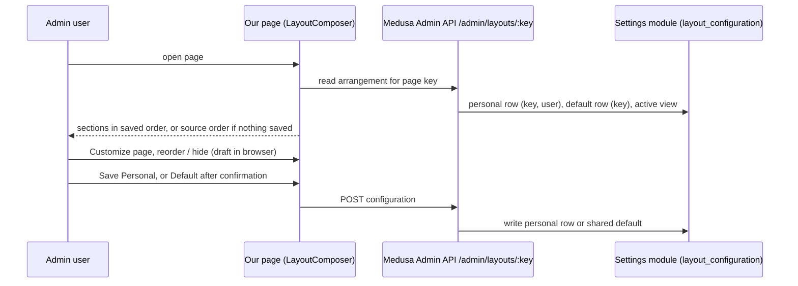

# Admin Page Layout Architecture

**Last updated:** 2026-10-23
**Related work:** NIMBUS-223 (sub-tasks NIMBUS-224 to NIMBUS-227)

## Overview

Our custom Medusa Admin pages render through Medusa's own page-layout component, `LayoutComposer`,
so the top bar's "Customize page" works on them as on Medusa's pages: an admin user can reorder and
hide sections and save the arrangement for themselves (Personal) or for every admin user (Default,
"Save for everyone"). Medusa stores the arrangements; we have no backend code, endpoint, table or
migration for it. The same component exposes Medusa's standard widget places on each page.

## Components

Backend app, Admin UI only (`apps/backend/src/admin/`):

| Part | File | Responsibility |
|---|---|---|
| Page keys | `lib/page-keys.ts` | One key per page, used as `widgetsZonePrefix`: the key Medusa stores arrangements under and derives widget places from (`<key>.before`, `<key>.after`, ...) |
| Page-key test | `lib/__tests__/page-keys.test.tsx` | Every exported key is unique, none starts another, and the set is exactly the seven keys below |
| Pages | `routes/*/page.tsx` | Wrap their content in `LayoutComposer` with a key, a core layout id and named entries |
| Jest stand-in | `__tests__/dashboard-components.tsx`, mapped in `jest.admin.config.js` | Replaces `@medusajs/dashboard/components` in Admin tests, which cannot load the real dashboard under jsdom |
| Test queries | `__tests__/layout-queries.ts` | `layoutEntry`, `layoutEntryIds`, `layoutSection` for page tests |

Pages, keys and entries (default order; entry ids are stored by Medusa as `core:<id>`):

| Page | Key | Layout | Entries |
|---|---|---|---|
| Approvals | `approval.list` | single column | `approvals` |
| Companies | `company.list` | single column | `companies` |
| Company details | `company.details` | single column, `data={company}` | `business-central-warning`, `company-information`, `business-central-customer`, `employees` |
| Quotes | `quote.list` | single column | `quotes` |
| Quote details | `quote.details` | two column, `data={quote}` | main: `quote-accepted` (only while the quote is accepted), `quote`, `messages`, `json`; side: `customer`, `company` |
| Translations | `storefront_translation.list` | single column | `translations` |
| Shipment tracking | `shipment_tracking.list` | single column | `given-up-shipments`, `all-shipments` |

Manage quote is a full-screen dialog, not a page, and has no layout (as Medusa's own edit dialogs).

Medusa side (core, 2.21.2): `LayoutComposer` and `LayoutComposer.Entry` from
`@medusajs/dashboard/components`, layout ids from `CORE_LAYOUT_IDS` in `@medusajs/admin-shared`
(`core:single-column`, `core:two-column` with a 440 px side column from extra-large screens up), and
the settings module's `layout_configuration` table behind `/admin/layouts/:zone/configuration`.

## Data Flow

Choosing Default and saving switches the user's active view back to the shared default; their
personal row is kept but not shown. Cancel writes nothing.

## Key Decisions & Constraints

- **Presentation only.** Customizing changes the arrangement on screen, nothing else. Hiding a section
  is never access control: its data is still loaded and reachable by anyone who can open the page.
- **Any admin may save the Default** ("Save for everyone"), Medusa's own rule; no extra permission
  check exists or was added (accepted in NIMBUS-223 scope).
- **Page keys must not clash.** Medusa matches a widget zone to a page by plain prefix, so no key may
  start another, and no key may equal, start or be started by a `widgetsZonePrefix` of Medusa's own
  pages; otherwise both pages share arrangements and widgets. That is why Translations uses
  `storefront_translation.list`: Medusa's Settings → Translations page uses `translation.list`.
- **Fixed, hand-written entry ids.** Saved arrangements refer to entries by id, so ids survive
  renames and minification. Renaming or removing an entry drops users' saved position for it; an
  unknown saved id is ignored, and an entry with no saved position shows at the top of its column.
  Changing a page key drops every saved arrangement for that page.
- **Everything inside a section is an entry.** Each direct child of a section becomes a movable
  entry, so `<Toaster />` and anything that must not move stay outside `sections`.
- **Early returns stay before the layout.** Company details' "Company not found" and Quote details'
  loading and preview-loading paths render no layout.
- **Hiding the first entry hides the page heading** on Shipment tracking and Company details, as on
  Medusa's pages (accepted).
- **The Business Central warning** on Company details is movable and hideable; first by default.
- **Detail pages pass their record** (`data`) so a future widget on `company.details` or
  `quote.details` receives it, as on Medusa's detail pages. No widget is installed today.
- **Tests do not exercise Medusa's behaviour.** The stand-in renders sections in default order and
  exposes `data-page-key`, `data-layout-id` and `data-layout-entry`; it ignores `data` and widgets.
  Edit mode, saving, reload and Default were verified by a browser click-through on every page
  (NIMBUS-223 final gate), not by tests.
- Personal rows are not removed when an admin user is deleted (Medusa's delete-users workflow has
  no settings step).

## Extension Points

- **New custom page:** add a key to `lib/page-keys.ts` (check it against Medusa's own
  `widgetsZonePrefix` values in `@medusajs/dashboard/dist`), update the exact-set assertion in
  `lib/__tests__/page-keys.test.tsx`, wrap the page in `LayoutComposer` with a `CORE_LAYOUT_IDS`
  layout and give each section's content a `LayoutComposer.Entry` with a fixed id. The pattern is in
  the `medusa-admin` skill's `project.md`.
- **New section on an existing page:** add an entry with a new id; it shows at the top of its column
  for users with a saved arrangement until they reposition it.
- **Widget on one of our pages:** use a zone starting with the page key (`<page key>.before`,
  `<page key>.after`, ...); detail-page widgets receive the company or quote as `data`. The Admin
  build warns, but does not fail, on zones not in Medusa's list.
- **Page test:** render the page as usual; the stand-in is applied by the Jest module mapping. Query
  entries with `__tests__/layout-queries.ts`.
