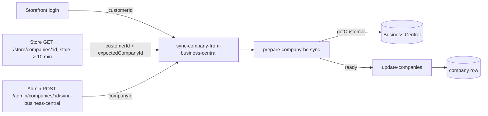

# Business Central Company Sync Architecture

**Last updated:** 2026-10-26
**Related work:** NIMBUS-156 (login sync), NIMBUS-160 (freshness sync), NIMBUS-161 (wrong-company
guard), NIMBUS-254 (Admin "Sync from Business Central")

## Overview

Business Central (BC) is the source of truth for a company's name, contact details, address,
blocked status, credit limit, VAT number and currency. Medusa keeps a copy of these BC-managed
fields on the `company` row and refreshes it from BC. There are three triggers: a customer logs in,
a customer opens the storefront company page when the copy is more than 10 minutes old, and an
Admin user runs "Sync from Business Central" on the Admin company page. All three run one workflow,
so there is a single field mapping and a single way of handling BC errors.

## Components

### Backend (`apps/backend/src`)

| Piece | File | Responsibility |
|---|---|---|
| Sync workflow (L4) | `workflows/company/workflows/sync-company-from-business-central.ts` | Runs the prepare step, writes the update only when it is `ready`, returns `{ status: "updated" \| "skipped" \| "failed" }`. |
| Prepare step (L3) | `workflows/company/steps/prepare-company-bc-sync.ts` | Finds the company and its BC customer number, reads the BC customer, builds the update. Owns the rule "what a BC company sync writes and its outcomes" (`ai/architecture/decisions.md`). |
| Update step (L3) | `workflows/company/steps/update-companies.ts` | Shared company update; reused unchanged. |
| BC client (L2) | `modules/business-central/service.ts` (`getCustomer`) | Returns the BC customer or `null`; throws `MedusaError` on expected failures. |
| Login sync route (L6) | `api/store/customers/me/company/sync-business-central/route.ts` | `POST`, called by the storefront after login (`apps/storefront/src/lib/data/customer.ts`). Input: the caller's customer id. |
| Freshness sync (L6) | `api/store/companies/[id]/route.ts` (`GET`) | Syncs before reading when `business_central_synced_at` is missing or older than 10 minutes. Input: customer id plus the path's company id as `expectedCompanyId`. A sync error is logged and the read continues. |
| Admin sync route (L6) | `api/admin/companies/[id]/sync-business-central/route.ts` | `POST`, body must be `{}` (strict schema in `api/admin/companies/validators.ts`, wired in `middlewares.ts`). Input: the path's company id. Returns `{ status }`. |
| Admin read fields | `api/admin/companies/query-config.ts` | Default fields include `business_central_synced_at` for `GET /admin/companies` and `/:id`. |
| Response type | `types/company/http.ts` | `AdminSyncCompanyBusinessCentralResponse`. |

### Admin UI (`apps/backend/src/admin`)

- `hooks/api/companies.tsx`: `useSyncCompanyFromBusinessCentral` posts `{}` and, on any settle,
  invalidates the company detail and list queries so the page refetches.
- `routes/companies/components/company-actions-menu.tsx`: the "Sync from Business Central" action
  and one toast per outcome (`skipped` is shown as "Nothing to sync"; an HTTP error gets a generic
  error toast). The action is disabled, with a tooltip, when the company has no BC customer number.
- `components/common/action-menu.tsx`: shared menu with an optional per-action `tooltip`. A disabled
  item has `pointer-events: none`, so the tooltip sits on a wrapper; a click on a disabled
  `onClick` action is ignored (Radix still calls `onClick` on disabled items).
- `routes/companies/[companyId]/page.tsx`: "Last synced from Business Central" row (date and time,
  or "Never").
- `routes/companies/bc-managed-fields.ts`: the list of BC-managed fields and the page banner text.

## Data Flow

The prepare step resolves the company in one of two ways, then shares everything else:

1. **Customer input** (`{ customerId, expectedCompanyId? }`): the company through the customer's
   employee record. If `expectedCompanyId` is given and differs, the outcome is `skipped` (the
   NIMBUS-161 guard).
2. **Company input** (`{ companyId }`): the company by id; an unknown id throws `NOT_FOUND`, which
   Medusa maps to 404. This path does not need employees.

Shared part:

| State | Outcome | Write |
|---|---|---|
| No company, or no BC customer number | `skipped`, no BC call | none |
| BC client throws `MedusaError` | `failed` (HTTP 200); logs the company id only | none |
| BC client throws anything else | propagates (5xx on the Admin route) | none |
| BC returns `null` | `skipped` | none |
| BC returns the customer | `updated` | the 12 BC-managed fields plus `business_central_synced_at = now` |

The input type forbids mixing the two shapes (`companyId?: never` on the customer variant and the
reverse), so a caller cannot pass a company id to skip the wrong-company guard.

## Key Decisions & Constraints

- **One workflow, two inputs.** Every trigger shares the field mapping in the prepare step; no
  trigger has its own copy. The BC-managed field list in `bc-managed-fields.ts` and the mapping must
  stay in step.
- **Written fields:** name, email, phone, address (BC address lines 1 and 2 joined), city, state,
  zip, country, blocked, credit limit, VAT number, currency code (a blank BC currency resolves to
  `BUSINESS_CENTRAL_LCY_CODE`, default `DKK`), and `business_central_synced_at`. The BC customer
  number and Medusa-only fields (order API setting, logo, spending-limit reset, employees, customer
  group, approval settings) are never written.
- **Values come only from BC.** The Admin route accepts only an empty body (any field gives 400) and
  uses the path id; the company's own BC number picks the BC customer.
- **Admin only.** The Admin route relies on Medusa's default `/admin` authentication (bearer,
  session or secret API key). Any secret Admin API key can therefore call it, as it can any Admin
  route.
- **No lock, no repeat-click guard.** Overlapping syncs each overwrite with BC's current values; the
  last writer wins. Who ran an Admin sync is not recorded; `business_central_synced_at` is the only
  trace.
- **Storefront delay.** The storefront caches the company response per visitor for up to about
  120 seconds, so a customer may see old values for that long after an Admin sync (accepted).
- **Blocked status and credit limit are display-only.** No checkout, approval or spending-limit rule
  reads them.
- **No personal data in logs.** Log lines carry the company id and fixed text only.
- **Known gap.** The shared `QueryCompany` type declares `business_central_synced_at` as `Date`, but
  over HTTP the Admin page receives an ISO string and converts it with `new Date(...)`.

## Extension Points

- **A new trigger** (for example a scheduled job) runs `syncCompanyFromBusinessCentralWorkflow` with
  one of the two inputs; a job follows the single-run lock rule in `ai/architecture/boundaries.md`.
- **A new BC-managed field**: add it to the mapping in the prepare step and to
  `BC_MANAGED_COMPANY_FIELDS`, and extend the sync tests in
  `integration-tests/http/customers/company-sync.spec.ts` and `companies/companies.spec.ts`.
- **A new outcome** changes the workflow result type, the store and Admin responses, and
  `SYNC_OUTCOME_TOASTS` in the Admin actions menu.
- Tests: workflow cases in `integration-tests/http/customers/company-sync.spec.ts`, Admin route
  contract in `integration-tests/http/companies/companies.spec.ts`, authorization negatives in
  `integration-tests/http/security/security-boundaries.spec.ts`, Admin UI in
  `src/admin/routes/companies/__tests__/company-bc-sync.test.tsx`.
