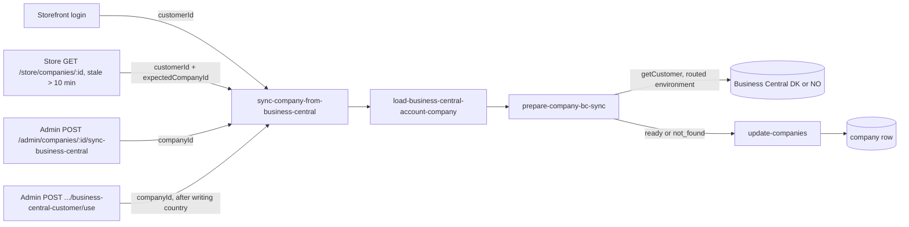

# Business Central Company Sync Architecture

**Last updated:** 2026-10-28
**Related work:** NIMBUS-156 (login sync), NIMBUS-160 (freshness sync), NIMBUS-161 (wrong-company
guard), NIMBUS-254 (Admin "Sync from Business Central"), NIMBUS-261 (sync per BC environment, the
"customer not found" record, the Admin "Business Central customer" section)

## Overview

Business Central (BC) is the source of truth for a company's name, contact details, address,
blocked status, credit limit, VAT number and currency. Medusa keeps a copy of these BC-managed
fields on the `company` row and refreshes it from BC. There are three triggers: a customer logs in,
a customer opens the storefront company page when the copy is more than 10 minutes old, and an
Admin user runs "Sync from Business Central" on the Admin company page. The Admin "Use this
customer" action also ends with a sync. All of them run one workflow, so there is a single field
mapping and a single way of handling BC errors.

The sync reads the company's own BC environment: Norway when the company's `country` is `NO`,
Denmark otherwise ([Business Central environments](./business-central-environments.md)). When that
environment has no customer with the company's number, the sync records this on the company, and
the Admin company page shows it and helps the admin correct it.

## Components

### Backend (`apps/backend/src`)

| Piece | File | Responsibility |
|---|---|---|
| Sync workflow (L4) | `workflows/company/workflows/sync-company-from-business-central.ts` | Loads the company, runs the prepare step, writes the update when it is `ready` or `not_found`, returns `{ status: "updated" \| "skipped" \| "failed" }`. |
| Company load step (L3) | `workflows/company/steps/load-business-central-account-company.ts` | Loads the company by id (unknown id: `NOT_FOUND`, 404) or through the customer's employee record (none: `null`). Shared with the account workflow. |
| Prepare step (L3) | `workflows/company/steps/prepare-company-bc-sync.ts` | Picks the environment from `country`, reads the BC customer, builds the update or the not-found record. Owns the rule "what a BC company sync writes and its outcomes" (`ai/architecture/decisions.md`). |
| Local currency rule (L5) | `workflows/company/utils/resolve-currency-code.ts` | A blank BC currency resolves to the environment's local currency (DKK or NOK). |
| Update step (L3) | `workflows/company/steps/update-companies.ts` | Shared company update; reused unchanged. |
| BC client (L2) | `modules/business-central/service.ts` (`getCustomer(environment, number)`) | Returns the BC customer or `null`; throws `MedusaError` on expected failures. |
| Login sync route (L6) | `api/store/customers/me/company/sync-business-central/route.ts` | `POST`, called by the storefront after login (`apps/storefront/src/lib/data/customer.ts`). Input: the caller's customer id. |
| Freshness sync (L6) | `api/store/companies/[id]/route.ts` (`GET`) | Syncs before reading when `business_central_synced_at` is missing or older than 10 minutes. Input: customer id plus the path's company id as `expectedCompanyId`. A sync error is logged and the read continues. |
| Admin sync route (L6) | `api/admin/companies/[id]/sync-business-central/route.ts` | `POST`, body must be `{}` (strict schema in `api/admin/companies/validators.ts`, wired in `middlewares.ts`). Input: the path's company id. Returns `{ status }`. |
| Admin BC customer routes (L6) | `api/admin/companies/[id]/business-central-customer/route.ts`, `lookup/route.ts`, `use/route.ts`; response mapping in `response.ts` | Status, the two-environment check and "Use this customer" (see below). |
| Lookup workflow (L4) and step (L3) | `workflows/company/workflows/lookup-business-central-customer.ts`, `steps/lookup-business-central-customer.ts` | Read-only: reads the card in DK and NO in parallel and reports each environment separately. |
| Use workflow (L4) | `workflows/company/workflows/use-business-central-customer.ts`, step `steps/read-business-central-customer-country.ts` | Re-reads the card in the chosen environment, writes `country` from it, then runs the sync workflow with `runAsStep`. |
| Admin read fields | `api/admin/companies/query-config.ts` | Default fields include `business_central_synced_at` for `GET /admin/companies` and `/:id`. |
| Response types | `types/company/http.ts` | `AdminSyncCompanyBusinessCentralResponse`, `AdminBusinessCentralCustomerResponse`, `AdminBusinessCentralCustomerLookupResponse`, `AdminUseBusinessCentralCustomerResponse`. |

### Admin UI (`apps/backend/src/admin`)

- `hooks/api/companies.tsx`: `useSyncCompanyFromBusinessCentral` posts `{}` and, on any settle,
  invalidates the company detail and list queries so the page refetches.
- `hooks/api/business-central-customer.tsx`: the status query, the lookup (a disabled query run only
  by `refetch()`, keyed by the customer number) and the "Use this customer" mutation. The status key
  sits under the company detail key, so an edit, a menu sync or "Use this customer" also reloads the
  section.
- `routes/companies/components/company-actions-menu.tsx`: the "Sync from Business Central" action
  and one toast per outcome (`skipped` is shown as "Nothing to sync"; an HTTP error gets a generic
  error toast). The action is disabled, with a tooltip, when the company has no BC customer number.
- `routes/companies/components/company-business-central-customer.tsx`: the "Business Central
  customer" section, entry `business-central-customer` on the company page, below company
  information ([admin page layout](./admin-page-layout.md)).
- `components/common/action-menu.tsx`: shared menu with an optional per-action `tooltip`. A disabled
  item has `pointer-events: none`, so the tooltip sits on a wrapper; a click on a disabled
  `onClick` action is ignored (Radix still calls `onClick` on disabled items).
- `routes/companies/[companyId]/page.tsx`: "Last synced from Business Central" row (date and time,
  or "Never").
- `routes/companies/bc-managed-fields.ts`: the list of BC-managed fields and the page banner text.

## Data Flow

The load step resolves the company in one of two ways, then the prepare step shares everything
else:

1. **Customer input** (`{ customerId, expectedCompanyId? }`): the company through the customer's
   employee record. If `expectedCompanyId` is given and differs, the outcome is `skipped` (the
   NIMBUS-161 guard).
2. **Company input** (`{ companyId }`): the company by id; an unknown id throws `NOT_FOUND`, which
   Medusa maps to 404. This path does not need employees.

Shared part (the environment is the company's routed environment):

| State | Outcome | Write |
|---|---|---|
| No company, or no BC customer number | `skipped`, no BC call | none |
| BC client throws `MedusaError` (including a missing or invalid setting for that environment) | `failed` (HTTP 200); logs the company id and environment only | none; an existing not-found record stays |
| BC client throws anything else | propagates (5xx on the Admin route) | none |
| BC returns `null` | `skipped` | the not-found record: time, environment, customer number tried (overwrites any earlier one) |
| BC returns the customer | `updated` | the 12 BC-managed fields, `business_central_synced_at = now`, and the not-found record cleared |

The input type forbids mixing the two shapes (`companyId?: never` on the customer variant and the
reverse), so a caller cannot pass a company id to skip the wrong-company guard.

### The "customer not found" record

Three nullable columns on `company`: `business_central_not_found_at` (`dateTime`),
`business_central_not_found_environment` (enum `DK`/`NO`) and
`business_central_not_found_customer_number` (text). The sync workflow's single company update
writes all three together and clears all three together; nothing else writes them. There is no
history: a company has at most one record. The customer number is kept because the admin may change
the number afterwards.

The record is not in the store company projection (an allowlist). It does reach a company's own
admins through two existing store wildcards, `carts.company.*` on `GET /store/approvals` and
`*company` on the store employee create and update responses, as the credit limit already does.
This was accepted in the NIMBUS-261 plan; narrowing those wildcards would be a separate issue.

### Admin "Business Central customer" section

All three routes use Medusa's default `/admin` authentication.

| Route | Does | Answers |
|---|---|---|
| `GET /admin/companies/:id/business-central-customer` | account workflow by company id | `{ routed_environment, customer_number, not_found: { at, environment, customer_number } \| null }`; `at` is ISO 8601; unknown company 404 |
| `GET …/business-central-customer/lookup` | reads the card in DK and NO in parallel, ignoring routing | `{ customer_number, results: [{ environment, status, customer }] }`, `status` one of `found`, `not_found`, `could_not_check`; `customer` is only `{ name, country, routes_to, routes_elsewhere }`; no customer number 400 |
| `POST …/business-central-customer/use` | strict body `{ environment: "DK" \| "NO" }`; re-reads the card there, writes `country` from it, runs the sync | `{ status, country }` with the sync's outcome; card gone 404 with nothing written; any other body field 400 |

The section shows the routed environment and the not-found record. "Check customer number in DK and
NO" is disabled without a customer number. Each environment shows its result, and every found card
offers "Use this customer". Found in both environments is normal for a Norwegian customer, so both
are offered without a warning. Found in neither shows a note and no action. When a card's country
routes to the other environment (`routes_elsewhere`), the section warns and asks for confirmation
before the action runs. After the action a toast reports the outcome, and the company and section
reload.

## Key Decisions & Constraints

- **One workflow, two inputs.** Every trigger shares the field mapping in the prepare step; no
  trigger has its own copy. The BC-managed field list in `bc-managed-fields.ts` and the mapping must
  stay in step.
- **Written fields:** name, email, phone, address (BC address lines 1 and 2 joined), city, state,
  zip, country, blocked, credit limit, VAT number, currency code (a blank BC currency resolves to
  the environment's local currency: `BUSINESS_CENTRAL_LCY_CODE`, default `DKK`, for DK;
  `BUSINESS_CENTRAL_NO_LCY_CODE`, default `NOK`, for NO), `business_central_synced_at`, and the
  three not-found columns. The BC customer number and Medusa-only fields (order API setting, logo,
  spending-limit reset, employees, customer group, approval settings) are never written.
- **The sync moves the company.** It writes `country` from the card, and the next BC call routes on
  that value. An Admin edit of `country` in the company form moves the company to the other
  environment until the next sync overwrites it from the card (accepted).
- **Not found is reported as `skipped`.** The workflow writes the record but keeps its three
  outcome values, so the store and Admin sync responses and their toasts are unchanged.
- **Values come only from BC.** The Admin sync route accepts only an empty body (any field gives
  400) and uses the path id; the company's own BC number picks the BC customer. "Use this customer"
  takes only the environment from the client and the country from the card re-read on the server.
- **"Use this customer" keeps the country when the sync then fails.** The country came from the card
  just read, and the admin sees the sync outcome. The update step's compensation restores the old
  country only if the workflow itself fails. A card with a blank country writes `country = ""`,
  which routes to DK (the section warns first, since `routes_elsewhere` is true for a NO card).
- **The lookup reveals only what the admin needs.** Per environment it returns the found flag, name
  and country, and where that country routes. A failure in one environment, configuration errors
  included, is `could_not_check` for that environment only and is logged with the company id and
  environment.
- **Admin only.** The Admin routes rely on Medusa's default `/admin` authentication (bearer,
  session or secret API key). Any secret Admin API key can therefore call them, as it can any Admin
  route.
- **Error answers.** A BC configuration or credential error on "Use this customer" answers a logged
  generic 500, as on the store BC routes ([Business Central
  environments](./business-central-environments.md)). The section shows one generic error toast for
  every answer except 404.
- **No lock, no repeat-click guard.** Overlapping syncs each overwrite with BC's current values; the
  last writer wins. Who ran an Admin sync or "Use this customer" is not recorded;
  `business_central_synced_at` is the only trace.
- **Storefront delay.** The storefront caches the company response per visitor for up to about
  120 seconds, so a customer may see old values for that long after an Admin sync (accepted).
- **Blocked status and credit limit are display-only.** No checkout, approval or spending-limit rule
  reads them.
- **No personal data in logs.** Log lines carry the company id, the environment and fixed text
  only, never the customer card or name. The not-found record holds no personal data.
- **Dates over the workflow boundary are strings.** Workflow and step results are serialised, so
  the account workflow and the status route return `not_found.at` as an ISO 8601 string. The shared
  `QueryCompany` type still declares `business_central_synced_at` as `Date`, but over HTTP the Admin
  page receives an ISO string and converts it with `new Date(...)` (known gap).

## Extension Points

- **A new trigger** (for example a scheduled job) runs `syncCompanyFromBusinessCentralWorkflow` with
  one of the two inputs; a job follows the single-run lock rule in `ai/architecture/boundaries.md`.
- **A new BC-managed field**: add it to the mapping in the prepare step and to
  `BC_MANAGED_COMPANY_FIELDS`, and extend the sync tests in
  `integration-tests/http/customers/company-sync.spec.ts` and `companies/companies.spec.ts`.
- **A new outcome** changes the workflow result type, the store and Admin responses,
  `SYNC_OUTCOME_TOASTS` in the Admin actions menu and `USE_OUTCOME_TOASTS` in the Business Central
  customer section.
- **A list of companies not found in BC** can filter on `business_central_not_found_at`; the
  columns were chosen over a JSON field for this.
- Tests: workflow cases in `integration-tests/http/customers/company-sync.spec.ts`, Admin route
  contracts in `integration-tests/http/companies/companies.spec.ts` (the Admin cases fail locally
  with a 401 on login until NIMBUS-236 is fixed; until then the unit specs
  `api/admin/companies/__tests__/business-central-customer-routes.unit.spec.ts` and
  `workflows/company/__tests__/{lookup,use}-business-central-customer.unit.spec.ts` cover them),
  authorization negatives in `integration-tests/http/security/security-boundaries.spec.ts`, Admin
  UI in `src/admin/routes/companies/__tests__/company-bc-sync.test.tsx` and
  `company-bc-customer.test.tsx`.
