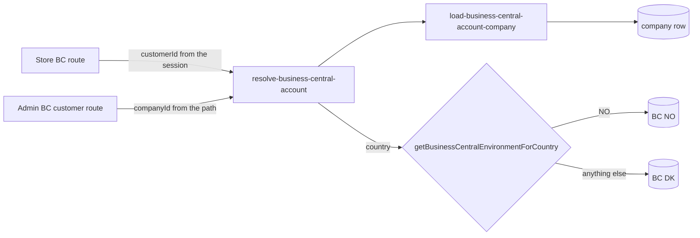

# Business Central Environments Architecture

**Last updated:** 2026-10-28
**Related work:** NIMBUS-261

## Overview

Nimbus Nordic runs two Business Central (BC) environments per stage: a Danish one (`DK`: TestDK,
ProductionDK) and a Norwegian one (`NO`: TestNO, ProductionNO). Both are in the same Entra tenant
and use the same app registration. The backend holds one connection per environment, and every BC
call names the environment it goes to. Customer-portal calls made for a company are routed by the
company's stored `country`. The order API, order submission and shipment notices always use `DK`.

## Components

### Backend (`apps/backend/src`)

| Piece | File | Responsibility |
|---|---|---|
| Environment type | `modules/business-central/types.ts` (`BusinessCentralEnvironment`) | `"DK" \| "NO"`. Every `IBusinessCentralModuleService` method except the disabled `getOperations` takes it as its first argument. |
| Configuration (L2) | `modules/business-central/environment-config.ts` | Per-environment settings: discovery URL, BC company GUID and local currency (LCY). Validates the URL whole (`https://api.businesscentral.dynamics.com/v2.0/{tenant}/{environment}/...`) before any call. Holds `businessCentralConfigurationError`. |
| BC client (L2) | `modules/business-central/service.ts` | Shared client id and secret. The shipment-read token and ODataV4 company-name cache is keyed per environment. Other calls request a token per call. |
| Routing rule (L5) | `utils/business-central-environment.ts` (`getBusinessCentralEnvironmentForCountry`) | `country` `NO`, trimmed and in any case, gives `NO`. Anything else, blank included, gives `DK`. This is the only place that compares `"NO"` (`ai/architecture/decisions.md`). |
| Account workflow (L4) | `workflows/company/workflows/resolve-business-central-account.ts` | Input `{ customerId }` (through the employee's company) or `{ companyId }`. Returns `companyId`, `customerNumber`, `environment` and the stored not-found record. An unknown company id gives 404. A customer without a company, or an unknown customer id, resolves to no number and `DK`. |
| Company load step (L3) | `workflows/company/steps/load-business-central-account-company.ts` | One `query.graph` read of the company columns the account workflow and the company sync need. |
| Local currency rule (L5) | `workflows/company/utils/resolve-currency-code.ts` (`resolveCurrencyCode`) | A blank BC currency resolves to the environment's local currency. |
| Test guard | `utils/business-central-test-environment.ts`, called from `integration-tests/global-setup.ts` | Tests abort unless the DK discovery URL, and the NO one when set, target an environment in `BUSINESS_CENTRAL_TEST_ENVIRONMENTS` (default `TestDK,TestNO`). Messages name the environment only. |

### Which environment each caller uses

| Caller | Environment |
|---|---|
| Store BC reads: `GET /store/bc-orders`, `/store/bc-orders/:id`, `/store/bc-orders/return-reasons`, `/store/bc-returns`, `/store/bc-returns/:number` | routed: the account workflow from the session customer |
| Return creation: `POST /store/bc-orders/:id/returns` (`create-bc-return` workflow, prepare and submit steps) | routed: the route passes the account's environment into the workflow |
| Company sync, every trigger ([company sync](./business-central-company-sync.md)) | routed: from the loaded company's `country` |
| Admin BC customer status (`GET /admin/companies/:id/business-central-customer`) | routed: shown to the admin |
| Admin two-environment check (`GET …/business-central-customer/lookup`) | both, in parallel; the only caller that ignores routing on purpose |
| Admin "Use this customer" (`POST …/business-central-customer/use`) | the environment the admin picks, for the card re-read; the sync that follows is routed |
| [Order submission](./business-central-order.md) (prepare and submit steps) and its currency override | `DK`, always |
| [Shipment notices](./order-api/shipment-notices.md) (scan and check steps) | `DK`, always |

## Data Flow

1. The route runs the account workflow with the session's customer id (store) or the path's company
   id (Admin). No request parameter, header or body field selects the environment.
2. A store route that needs a customer number answers 400 when there is none, as before. Return
   reasons need only the environment.
3. The route calls the BC module with the environment. The module builds the URL from that
   environment's discovery URL and, for ODataV4 and custom-API calls, its company GUID and company
   name.
4. A blank currency on a return detail, or on a synced company, becomes the environment's local
   currency (DKK or NOK).

### Configuration

| Variable | DK | NO |
|---|---|---|
| Discovery URL | `BUSINESS_CENTRAL_DISCOVERY_URL` (default TestDK) | `BUSINESS_CENTRAL_NO_DISCOVERY_URL` (no default) |
| BC company GUID | `BUSINESS_CENTRAL_COMPANY_ID` | `BUSINESS_CENTRAL_NO_COMPANY_ID` |
| Local currency | `BUSINESS_CENTRAL_LCY_CODE` (default `DKK`) | `BUSINESS_CENTRAL_NO_LCY_CODE` (default `NOK`) |
| Client id and secret | `BUSINESS_CENTRAL_CLIENT_ID`, `BUSINESS_CENTRAL_CLIENT_SECRET` (shared) | shared |

`apps/backend/.env.template` documents them with TestNO's values. Hosted stages set them as Medusa
Cloud variables.

## Key Decisions & Constraints

- **The environment is a required argument.** A new or forgotten caller fails to compile instead of
  reaching Denmark by default. Order submission and shipment notices pass `"DK"` explicitly, with a
  comment.
- **Derived on the server only.** The environment comes from the stored company. The two store
  list routes answer an extra `environment` query parameter with 400 (strict validators). The other
  store routes ignore it and stay on the company's environment.
- **Case-insensitive rule.** The sync writes the card's upper-case code (`NO`), and the Admin
  company form writes a lower-case `iso_2` (`no`). Both route to Norway.
- **The same customer number is the same customer in both environments.** Norwegian customers are
  normally registered in both (ProductionNO: 299 of 301 numbers also exist in ProductionDK). Every BC
  query keeps its customer-number filter, so routing does not widen what a user can read.
- **DK-only history of a Norwegian company is no longer shown.** Its orders and returns that exist
  only in the Danish environment disappear from the portal. The business accepts this.
- **A missing NO setting fails only NO calls.** NO has no default URL, so it can never reach another
  environment by accident. Danish companies are unaffected.
- **Configuration and credential errors answer a generic 500.** A missing or invalid setting, a bad
  client id or secret, and a token request Azure AD rejects throw a `MedusaError` with the custom
  type `business_central_configuration`. Medusa's error handler does not map that type. It logs the
  error with its message and answers 500 with the fixed body `{ code: "unknown_error", type:
  "unknown_error", message: "An unknown error occurred." }`, so no variable name, tenant or app id reaches the shopper. Azure AD's AADSTS text
  names the app and tenant, which is why the token rejection gets the same type. The same applies on
  every store BC route and on the Admin "Use this customer" route. The error is still a
  `MedusaError`, so the company sync reports `failed` and the Admin check reports `could_not_check`
  for that environment. Other BC response failures (`UNEXPECTED_STATE`, fixed texts with a status
  code) still echo their message in the 500 body. They name no setting, tenant, app or URL.
- **Return creation error answers.** A failed workflow rejects with a serialised error, so the
  return route reads its `name` and `type` rather than using `instanceof`. Line validation errors
  (`name` `BcReturnValidationError`) give 400 with the message. A `not_found` error gives 404 "Order
  not found.", which includes an order that exists only in the other environment. An ambiguous BC
  outcome gives 503. Everything else gives a logged generic 500.
- **The standard API URL has no `companies(...)` segment.** Calls such as `customers` and
  `salesOrders` rely on the environment's default BC company. This is verified for TestDK and TestNO
  (one company each). ProductionDK holds two companies, so the go-live probe confirms that the
  unscoped API resolves to Nimbus Nordic A/S there.
- **The customer-portal BC extension must exist in each environment.** Return creation, open return
  detail, order reservations and return reasons use it. It was deployed to TestNO by 2026-10-28.
  There, ODataV4 `CS_EnabledReasonCodes` still answered 404, so return reasons fail for NO
  companies in TestNO. Nothing calls that route today, and return creation always sends the reason
  `NORMAL` (NIMBUS-138). Production go-live of NO routing waits for the extension in ProductionNO.
- **No new token cache.** Only the existing shipment-read cache (DK in practice) is keyed per
  environment, so a token or company name from one environment is never used for the other.

## Extension Points

- **A new BC call:** take `BusinessCentralEnvironment` as the first argument, with no default. A
  call made for a company gets its environment from `resolveBusinessCentralAccountWorkflow`, never
  from the request.
- **Routing a DK-only area (order submission, shipment notices):** the caller needs the company
  first. Replace its explicit `"DK"` with the account workflow's environment, and move the
  currency override's `resolveCurrencyCode("DK", …)` with it.
- **A third environment:** extend the `BusinessCentralEnvironment` union, `SETTINGS` in
  `environment-config.ts`, the routing rule and its registry row, `LOOKUP_ENVIRONMENTS` in
  `workflows/company/steps/lookup-business-central-customer.ts`, the `company`
  `business_central_not_found_environment` enum (a generated migration), the Admin `use` validator
  in `api/admin/companies/validators.ts`, `ENVIRONMENT_NAMES` in the Admin section, and the test
  guard's default allowlist.
- **Tests:**
  - module configuration, caches and error mapping: `modules/business-central/__tests__/environments.spec.ts`;
  - the rule and the guard: `utils/__tests__/business-central-environment.unit.spec.ts` and
    `business-central-test-environment.unit.spec.ts`;
  - the account workflow: `integration-tests/http/customers/business-central-account.spec.ts`;
  - store routing, the client-environment negatives and the generic 500s:
    `integration-tests/http/business-central/store-bc-reads.spec.ts`.
