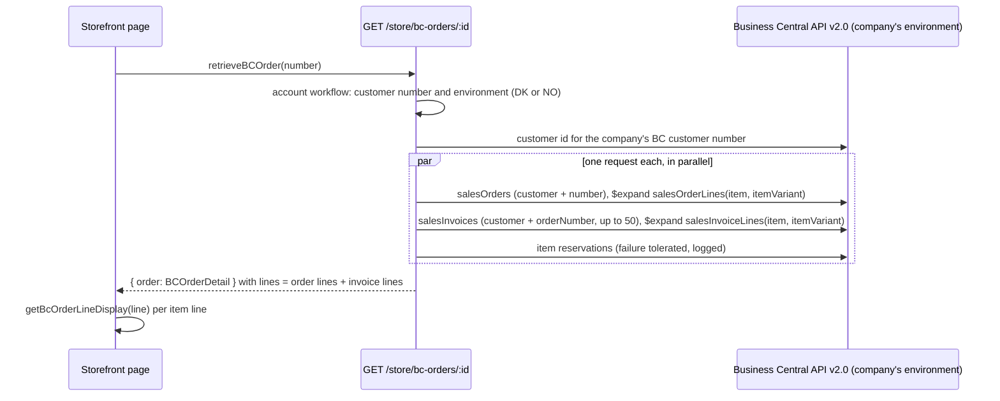

# Business Central Order Detail Architecture

**Last updated:** 2026-10-28
**Related work:** NIMBUS-255 (size on order detail lines; tasks NIMBUS-256, NIMBUS-257), NIMBUS-170
(BC sales orders and invoices merged in order history), NIMBUS-137 (order detail), NIMBUS-261 (read
from the company's BC environment)

## Overview

The customer portal's order detail page (`/account/bcorders/<number>`) shows a Business Central
(BC) order as BC holds it: the open sales order, its posted invoices, or both. The portal stores
none of it; every page load reads BC live through the backend. The same page holds the return table,
which lists the order's item lines for a return request. Order submission to BC is a separate area
(`business-central-order.md`). The order is read from the company's own BC environment, Norway or
Denmark ([Business Central environments](./business-central-environments.md)).

## Components

### Backend (`apps/backend/src`)

| Piece | File | Responsibility |
|---|---|---|
| Store route | `api/store/bc-orders/[id]/route.ts` | `GET /store/bc-orders/:id`: resolves the company's BC customer number and environment with `resolveBusinessCentralAccountWorkflow` (400 without a number), calls `getOrder(environment, …)`, 404 when BC has nothing |
| Middleware | `api/store/bc-orders/middlewares.ts` | customer authentication on every `/store/bc-orders*` route |
| BC adapter | `modules/business-central/service.ts` (`getOrder`, `mapSalesOrderLine`, `mapSalesInvoiceLine`, `variantCodeOf`) | reads the order and its invoices from BC API v2.0 and maps both kinds of line to one `BCOrderLine` shape |
| Response type | `modules/business-central/types.ts` (`BCOrderDetail`, `BCOrderLine`) | the order detail contract |

### Storefront (`apps/storefront/src`)

| Piece | File | Responsibility |
|---|---|---|
| Data function | `lib/data/business-central.ts` (`retrieveBCOrder`) | calls the store route; 404 becomes `null` (not-found page) |
| Line display rule | `lib/util/bc-order-line-display.ts` (`getBcOrderLineDisplay`) | pure helper: the name, extra description and size shown for an item line |
| Order lines table | `modules/account/templates/bc-order-detail-template.tsx` | renders every line: comment lines as plain text, item lines through the helper |
| Return table | `modules/account/components/bc-order-return/index.tsx` | item lines with quantity above zero, rendered through the same helper; submits returns by line number |
| Types | `types/bc-order.ts` | storefront copy of `BCOrderLine` (domain types are duplicated per app) |

## Data Flow

- With an open order, `lines` are the order's lines (sorted by sequence) followed by every invoice's
  lines; `invoiceStatus` is `open` or `partially_invoiced`. Without one, the order is built from its
  invoices alone (`fully_invoiced`).
- Each line carries `variantCode`, the BC item variant code, when BC returns a non-empty one. Every
  variant in use is a size, so the storefront labels it "Size". Lines without a variant (comment
  lines, items without variants) have no `variantCode` key at all.

## Key Decisions & Constraints

- **Size comes from the item variant, never from the description.** On open order lines BC puts the
  size in the line description; on invoice lines the description repeats the product name. The
  variant code is the only field that is the size on both (verified on TestDK, 2026-10-26).
- **Line display rule** (one home: `getBcOrderLineDisplay`, registered in
  `ai/architecture/decisions.md`): the name is the item display name, else the description, else the
  item number. The description is shown in addition only when it differs from both the name and the
  size, compared trimmed and case-insensitive. The size is shown as its own line, "Size: <code>",
  only when present. Non-item, non-comment lines keep their description or item number, without a
  size.
- **The size label is one ICU message**, `Account.bcOrderReturn.size` (`"Size: {size}"`), so each
  locale owns its punctuation (French `"Taille : {size}"`). Runtime text comes from the
  database-backed UI translations, so the key is imported there before a storefront release.
- **No extra BC request.** The variant is an `$expand` on the two reads the page already makes. The
  catch: if a BC environment rejects the `itemVariant` expand on invoice lines, the whole order
  detail read fails, not just the size (production behaviour unverified at ship time).
- **Display only.** A return request still identifies lines by line number; `variantCode` is not
  sent back.
- **Customer scoping.** Both BC reads filter on the BC customer id resolved from the session's
  company; the order number alone never reaches another customer's order. The environment also
  comes from the session's company, never from the request. An order that exists only in the other
  environment is not found (404).
- **Errors.** A BC configuration or credential error answers a logged generic 500 with no setting
  name in the body ([Business Central environments](./business-central-environments.md)). Until
  the customer-portal extension is in an environment, the reservations read fails there; it is
  tolerated and logged, so the order still loads without reservations.
- **Returns use the same environment.** The return table posts to
  `POST /store/bc-orders/:id/returns`, which reads and validates the source order and creates the
  return order in the company's environment. Its error answers: 400 for a line validation error,
  404 "Order not found.", 503 for an ambiguous BC outcome, otherwise a logged generic 500.

## Extension Points

- A new line field from BC: add it to the raw line types and both mappers in
  `modules/business-central/service.ts` (open order and invoice lines must stay one shape), to
  `BCOrderLine` in both apps, and request it in the existing `$expand` rather than a new call.
- A change to what an item line shows: change `getBcOrderLineDisplay` and its tests
  (`src/__tests__/lib/util/bc-order-line-display.test.ts`); both tables pick it up. The name /
  description / size cell markup is duplicated in the two components, so a layout change touches
  both.
- New UI text on this page goes under `Account.bcOrderReturn` (or the page's namespace) in every
  `messages/*.json` and is imported into the database-backed translations.
