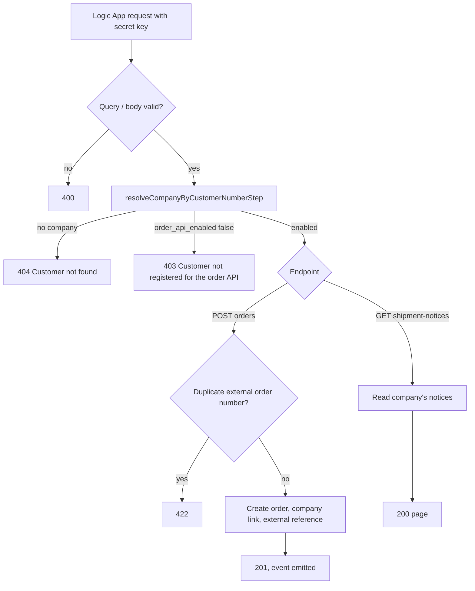

# Order API Architecture

**Last updated:** 2026-10-24
**Related work:** NIMBUS-129, NIMBUS-130, NIMBUS-192, NIMBUS-217, NIMBUS-207

## Overview

The order API (`/orderapi/*`) lets B2B customers' systems place orders in Medusa and read shipment
notices for them, through an Azure Logic App behind APIM. The customer key is checked outside
Medusa (APIM / Logic App, NIMBUS-178); Medusa authenticates the Logic App's single secret API key
and decides per company whether the customer may use the API at all (`company.order_api_enabled`,
NIMBUS-217). Shipment discovery, checks and the notice contract are in
[shipment-notices.md](./shipment-notices.md).

## Components

Paths are relative to `apps/backend/src/`.

| Component | Responsibility |
|-----------|----------------|
| `api/orderapi/middlewares.ts` | Secret API key authentication (`authenticate("user", ["api-key"])`) and strict query/body validation for both endpoints |
| `api/orderapi/orders/route.ts` | `POST /orderapi/orders?customerNumber=…`: runs intake, then emits `order_ingestion.order_created` fire-and-forget; 201 `{ order_id, status }` |
| `api/orderapi/shipment-notices/route.ts` | `GET /orderapi/shipment-notices?customerNumber=…&after|since&limit`: one page of the company's notices |
| `workflows/order-ingestion/steps/resolve-company-by-customer-number.ts` | Shared by both endpoints: customer number → company, refuses unknown (404) and switched-off (403) companies |
| `utils/order-api-access.ts` | The single home of the rule "a company may use the order API" (`isCompanyEnabledForOrderApi`), plus the shared `ORDER_API_COMPANY_FIELDS` selection and `OrderApiCompanyRow` type |
| `workflows/order-ingestion/workflows/create-order-from-canonical-payload.ts` | Intake: resolve company, duplicate check, create order, order–company link, external reference |
| `workflows/order-ingestion/workflows/enrich-order.ts` (via `subscribers/order-ingestion-created.ts`) | Moves the ingestion state to `ready_for_business_central` and emits the event that starts [Business Central submission](../business-central-order.md) |
| `modules/company/models/company.ts` | `order_api_enabled` boolean, not null, default `false` |
| `api/admin/companies/validators.ts`, `admin/routes/companies/**` | Admin update accepts `order_api_enabled`; the company page shows "Order API: Enabled/Disabled" and the edit drawer has a switch |

## The company setting

`company.order_api_enabled` gates the whole order API: order intake, the shipment-notices
endpoint, shipment discovery, the shipment check run and the Admin shipment retry. Only an
explicit `true` enables; a missing company counts as switched off.

| Path | Can set it? |
|------|-------------|
| `POST /admin/companies/:id` (Admin edit drawer) | yes, the only writer |
| `POST /admin/companies` (create) | no: the strict schema rejects the field with 400, so every new company starts off |
| Store company routes | no: strict schemas reject it (400) and the store company projections never return it |
| Business Central company sync | no: it writes only the BC-managed fields |
| Migration at deploy | every existing company got `false` |

The approvals list wildcard selection (`carts.company.*`) shows the caller's own company's flag
read-only; this was accepted (NIMBUS-217 plan decision 5). Store quote responses expose only the
company name, so they do not return the flag (NIMBUS-207).

The setting is read from the database on every request and every job run; there is no cache, so a
switch takes effect at the next request or the next poll run. Switching a company off does not
touch orders it already placed: they continue through Business Central submission as before.

## Data Flow

### Responses

| Condition, checked in this order | Status | Body message |
|---|---|---|
| Missing or invalid secret key | 401 | Medusa default |
| Invalid query or order body | 400 | validation message |
| Customer number matches no company | 404 | "Customer not found" |
| Company has `order_api_enabled = false` | 403 | "Customer not registered for the order API" |
| Intake: external order number already accepted for this company | 422 | echoes only the caller's external order number |
| Otherwise | 201 (intake) / 200 (notices) | |

The 404 and 403 bodies are fixed strings: they never carry the customer number or the company id
(NIMBUS-192, NIMBUS-217). The unknown-customer warn log line carries the customer number only;
the switched-off warn line carries the company id only.

## Key Decisions & Constraints

- **One check for both endpoints.** Both workflows start with the same resolve step, so the 404
  and 403 are decided in one place, before any write (intake) or read (notices).
- **Existence oracle accepted.** 404 (unknown) and 403 (known, switched off) differ, so a holder
  of the secret key can tell them apart. Accepted because the key is admin-equivalent and held only
  by the Logic App, which sets the customer number from the caller's APIM token.
- **Secret key = Admin user actor.** Medusa's only secret-API-key actor type is `user`; the key is
  never given to customer systems.
- **No lock around the setting.** A switch-off that lands while an intake request is already past
  the resolve step does not stop that order (an accepted race of milliseconds).
- **Errors are `MedusaError`s from steps.** `FORBIDDEN` maps to 403, `NOT_FOUND` to 404,
  `DUPLICATE_ERROR` to 422; Medusa returns the message verbatim, so messages must stay free of
  identifiers. Routes do not catch workflow rejections.

## Extension Points

- A new consumer of "may this company use the order API" calls `isCompanyEnabledForOrderApi` on a
  company row selected with `ORDER_API_COMPANY_FIELDS`; never compare `order_api_enabled` inline
  (one home per rule, `ai/architecture/decisions.md`).
- A new `/orderapi` endpoint for a customer starts its workflow with
  `resolveCompanyByCustomerNumberStep` and registers its auth and validation in
  `api/orderapi/middlewares.ts`; it then inherits the 404/403 contract.
- Negative cases for access live in `integration-tests/http/orderapi/*.spec.ts` and
  `integration-tests/http/security/security-boundaries.spec.ts`; test seeds create API companies
  switched on (`createApiCustomerCompany`).
- APIM / the Logic App must pass the 403 through to the caller as they do the 404 (NIMBUS-178); a
  refused order is not stored in Medusa, so it must not be retried silently.
