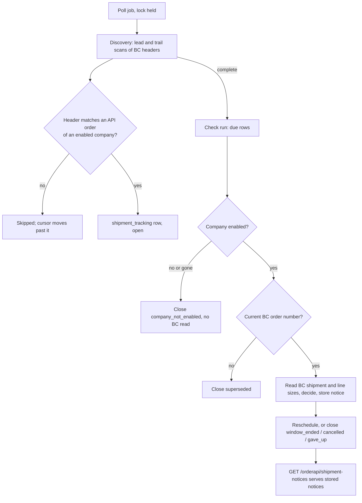

# Shipment Notices Architecture

**Last updated:** 2026-10-28
**Related work:** NIMBUS-130, NIMBUS-191, NIMBUS-216, NIMBUS-217, NIMBUS-231, NIMBUS-261

## Overview

Medusa finds the shipments Business Central posts for orders received through the
[order API](./overview.md), re-checks them for changes, stores each observed change as a numbered
shipment notice and serves the notices to the Logic App through
`GET /orderapi/shipment-notices`. Only companies switched on for the order API
(`company.order_api_enabled`) are discovered, checked and served (NIMBUS-217).

## Components

Paths are relative to `apps/backend/src/`.

| Component | Responsibility |
|-----------|----------------|
| `jobs/poll-shipment-notices.ts` | Every minute; single run via the `shipment-notice-poll` lock (TTL 600 s); disabled under `NODE_ENV=test` |
| `workflows/shipment-notice/workflows/poll-shipment-notices.ts` | One run: discovery, then the due checks, under one deadline; skips BC entirely during a throttling back-off |
| `workflows/shipment-notice/workflows/discover-shipments.ts`, `steps/scan-shipment-windows.ts` | Scans posted BC shipment headers by modification time and creates `shipment_tracking` rows for headers that match an API order of an enabled company |
| `workflows/shipment-notice/workflows/check-shipments.ts`, `steps/prepare-shipment-checks.ts`, `steps/check-shipments.ts` | Up to 200 due tracking rows per run: close, read BC, decide, store a notice, reschedule |
| `workflows/shipment-notice/utils/` | Pure rules: header-to-order match, line netting and notice decision, check schedule, scan windows, notice paging |
| `workflows/shipment-notice/workflows/list-shipment-notices.ts` | The endpoint read: shared company resolve step (404/403), then one page |
| `workflows/shipment-notice/workflows/reopen-shipment-tracking.ts` | Admin retry of a row that gave up; refuses switched-off companies first |
| `modules/order-ingestion` | Tables `shipment_tracking`, `shipment_notice`, `shipment_notice_state` (poll cursors, go-live, back-off); wire contract in `shipment-notice-contract.ts` |
| `modules/business-central` (`service.ts`, `shipment-reads.ts`) | BC reads for the check run: `getShipmentsByNumbers` (API v2.0 shipments and lines) and `getShipmentLineVariants` (ODataV4 `TRCShipmentLine` sizes); shared shipment-read token, timeout, deadline and throttling handling |
| `api/admin/shipment-tracking/**`, `admin/routes/shipment-tracking/page.tsx` | Admin list of gave-up rows with Retry, and the overview of all tracked shipments with their close reason |

## Data Flow

### Discovery

- The lead scan follows the clock 15 minutes behind (settling time); the trail scan re-reads 30
  minutes further back for headers BC made visible late. A window over 1000 headers is halved.
- A header matches when its customer number is an enabled company's
  `business_central_customer_number`, its external document number is that company's API order,
  and its order number is the order's current BC order number. Shipments posted before the go-live
  day are never matched.
- Headers of switched-off companies are filtered in memory after the existing company query (no
  extra BC request); the cursors still pass them, so they are not back-filled when the company is
  switched on later. Exception: a company switched on before the trail scan passes a header (up to
  about 45 minutes after the header's last change) still gets it tracked; accepted.

### Check run

- Due rows are read oldest first, with each row's latest stored revision and, in one query, each
  row's company setting.
- A row whose company is switched off or no longer exists closes with `company_not_enabled` before
  any BC read and before the superseded check. It counts as checked and sets `last_checked_at`.
- Other rows: shipments under a replaced BC order number close `superseded`; the rest are read from
  BC (shipments, then their line sizes, see [Line size](#line-size-variant_code)), decided (sizes
  joined, undo corrections netted) and stored as a `shipped`, `revised` or `cancelled` notice
  against the revision read before the BC read (a newer one makes it a conflict and re-due).
- A failed check stores a code in `last_error` and logs it with the shipment and BC order number:
  `bc_error` (a BC read failed), `not_returned` (BC did not return the shipment), `unpairable` (an
  undo correction matches no line, with the BC line number) or `variant_missing` (an item line has
  no size row, with the BC line number). All back off as below; a throttled read (429/503) or the
  run's deadline leaves the rows due and untouched instead.
- Schedule: first check 15 minutes after the header's last change, then every 15 minutes until 14
  days after posting; failures back off 15 min, 1 h, 4 h, 6 h, and give up 3 days after the later of
  the window's end and an Admin reopen.

### Tracking row states

| State | Event | Outcome |
|---|---|---|
| open, company on | comes due | checked as above |
| open, company off or gone | comes due | closed `company_not_enabled` |
| closed `company_not_enabled` | company switched on | stays closed; only new shipments are found |
| closed `gave_up`, company on | Admin Retry | reopened, due now (`reopened_by` = Admin user) |
| closed `gave_up`, company off | Admin Retry | 400 "The company is not enabled for the order API"; row unchanged |
| not `gave_up` (open or another reason), company on | Admin Retry | 400 "Only a shipment that gave up can be retried" |
| not `gave_up`, company off | Admin Retry | 400 company message (the company check runs first) |
| no such row | Admin Retry | 404 |

Close reasons: `cancelled`, `window_ended`, `superseded`, `gave_up`, `company_not_enabled`. Only
`gave_up` can be reopened.

### Line size (`variant_code`)

Every notice line carries `variant_code`, the size: the BC variant code posted on that shipment
line, trimmed, null when empty (an item without sizes). BC API v2.0 shipment lines have no variant,
so the size comes from a second read of the third-party ODataV4 web service `TRCShipmentLine`
(`documentNumber`, `lineNo`, `variantCode` only), joined to the v2.0 lines on shipment number and
line number (`lineNo` = v2.0 `sequence` = notice `bc_line_number`).

- **Request budget.** Per batch of up to 20 shipment numbers the check run makes one v2.0 read and,
  right after it, one `TRCShipmentLine` GET with an `or` filter over the same numbers, plus any
  next pages (followed only to the configured BC origin). A run checks at most 200 rows, so at most
  10 size reads. The ODataV4 `company` parameter needs the company name: it is read once per
  shipment-read token (`GET {discovery}/companies({BUSINESS_CENTRAL_COMPANY_ID})`, through the same
  timeout, deadline and throttling path) and cached with the token, so a token renewal costs one
  extra request. The check run therefore needs `BUSINESS_CENTRAL_COMPANY_ID` (a GUID, also required
  by the return reads); without it every check fails `bc_error` and backs off. Shipment discovery
  and checks always read the Danish BC environment (NIMBUS-261); the token and company-name cache is
  keyed per environment ([Business Central environments](../business-central-environments.md)).
- **Failures.** The size read sits in the same failure handling as the shipment read: throttled
  (also on the company-name read) sets the run's back-off; the deadline leaves the batch due; any
  other failure (status, timeout, malformed body, a next link to another host) fails every row of
  the batch with `bc_error`. An item line with no size row fails only its own shipment with
  `variant_missing`; a size is never guessed.
- **Change detection.** The size is not in the content hash (BC line, item, unit, net quantity), so
  adding it creates no `revised` notice for a shipment already notified. Undo corrections pair with
  the line they undo only when the variant code matches too (else `unpairable`).
- **Cut-off.** Notices recorded before NIMBUS-231 was released were stored without the key; they
  are never rewritten or back-filled and are served with `variant_code: null` on every line (the
  page builder fills it), even for sized items. In XML, APIM omits null fields, so those lines have
  no `<variant_code>`. Production had no shipment notices when the field was added (2026-10-24), so
  only test data is affected.
- **Dependency risk.** `TRCShipmentLine` belongs to a third-party BC extension whose owner is
  unknown. If the service changes or disappears, every check fails (`bc_error`, or
  `variant_missing` if rows go missing), backs off and gives up after its window; no notice is
  recorded without sizes. Fallback: Nimbus publishes the standard Posted Sales Shipment Lines page as
  an ODataV4 web service and the read in `shipment-reads.ts` moves to it.

### Reading notices

`GET /orderapi/shipment-notices` takes `customerNumber`, `limit` (1–200, default 50) and either
`after` (a decimal cursor) or `since` (ISO timestamp), never both. Notices are ordered by their
stored sequence; the response is `{ shipment_notices, next_cursor, has_more }`, and an empty page
echoes `after`. Access is decided by the shared resolve step: unknown customer 404, switched-off
company 403 (see [overview.md](./overview.md#responses)). Notices stored before a switch-off are
kept and served again once the company is switched back on.

## Key Decisions & Constraints

- **The rule has one home.** Discovery, the check run and the Admin retry all call
  `isCompanyEnabledForOrderApi` (`utils/order-api-access.ts`) on rows selected with
  `ORDER_API_COMPANY_FIELDS`; `OrderApiCompanyRow` requires `order_api_enabled`, so a selection that
  omits the column fails to compile instead of silently closing every open row.
- **No added BC load.** Filtering by the setting adds one `companies` query per batch and no BC
  request.
- **Closing is final.** A switched-off company's rows close when they next come due (normally
  within 15 minutes, up to 6 hours in back-off); switching it on again never reopens them.
- **Single run.** The job holds an in-memory lock (no Redis), so it does not guard across
  instances (`ai/architecture/boundaries.md`, Locks).
- **No personal data in logs.** Job log lines carry shipment and BC order numbers and error codes
  only, never BC response text, company contact data or customer numbers.
- **Where the contract lives.** This doc and the wire contract (`shipment-notice-contract.ts`) are
  the current contract. The customer-facing JSON Schema, the XSD of APIM's XML rendering and the
  examples mirror it; change them together. `issues/NIMBUS-231/artifacts/` holds the copies
  deployed at the NIMBUS-231 release (the error schema and error examples are still those in
  `issues/NIMBUS-130/artifacts/`); case folders are frozen records, so a later contract change
  publishes new copies with its own case. The closed schemas reject unknown fields: adding a field
  replaces them for customers who validate.

## Extension Points

- A new close reason: add it to `SHIPMENT_TRACKING_CLOSE_REASONS`, generate the `orderIngestion`
  migration (the check constraint is dropped and re-created), add the outcome to
  `scheduleShipmentCheck` and the Admin label map in `admin/routes/shipment-tracking/page.tsx`.
- A new reason to skip a company: extend the rule in `utils/order-api-access.ts`, not the
  individual consumers.
- Matching, netting and scheduling are pure functions in `workflows/shipment-notice/utils/` with
  unit tests; change the rule there and keep steps as I/O.
