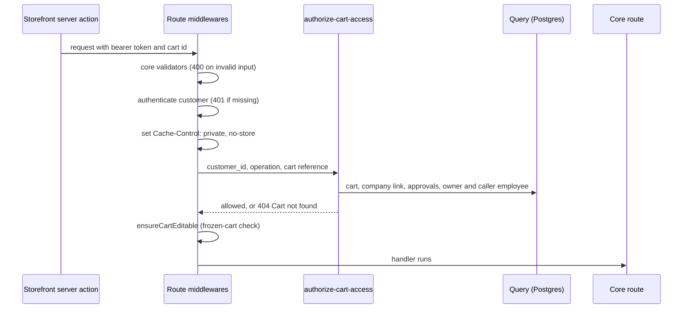

# Store cart and order access

**Last updated:** 2026-10-24
**Related work:** NIMBUS-177 (with the gate fixes NIMBUS-202 and NIMBUS-204), NIMBUS-133, NIMBUS-207

## Overview

Carts are personal and belong to a signed-in customer. A cart or order ID is never a credential:
every Store API request that reads or changes a cart or an order, directly or through another
resource, is checked against the caller's token and a fresh database read before the route runs.
Company administrators have one narrow exception, for reviewing and paying a colleague's cart under
an `admin` approval. The storefront follows the same model: it needs a signed-in customer for any
cart, keeps only an owned cart in its cookie, and caches no per-caller response.

The full rule tables (who may do what, the error each refusal gives, the residual transfer
exposure) and the rollout procedure are in
[`docs/security-remediation.md`](../security-remediation.md), sections "Cart access", "Order access"
and "Cart and order access rollout". This document describes how the code is put together.

## Components

### Store quote response projection

All seven store quote response routes (create, list, retrieve, preview, accept, reject and message)
share `api/store/quotes/query-config.ts`. Company data contains only `name`, for company employees
and administrators alike. Message-author records contain only `first_name` and `last_name`;
message IDs, text, item/customer/admin references and timestamps remain available. The owned
customer's contact fields, employee spending limit and administrator flag remain available.

Medusa's exact-path allowlist silently strips caller-selected fields outside this projection,
including parent wildcards, colleague collections and author emails. Unallowed sort fields return
400. The local relation-depth limit is four to retain draft-order item/variant/product expansion;
the global limit is unchanged. Existing customer-scoped queries and workflow ownership checks
still decide which quote may be read or changed. HTTP privacy and ownership cases live in
`integration-tests/http/security/security-boundaries.spec.ts`; middleware behavior is pinned by
`src/api/store/quotes/__tests__/query-config.unit.spec.ts`.

### Public customer password recovery

The country-prefixed `/forgot-password` and `/reset-password` storefront pages are public,
dynamic and excluded from indexing. Their forms call the server actions in
`lib/data/password-recovery.ts`. Opening a link performs no credential mutation. Missing or
rejected proofs offer a fresh request; completion returns the customer to ordinary login without
creating an authenticated session.

Recovery uses Medusa's Auth endpoints and proof storage:

- `POST /auth/customer/emailpass/reset-password` accepts `{ identifier, metadata: { country_code } }`.
  Known and unknown accounts receive the same acknowledgement; a provider failure also receives
  the neutral core acknowledgement.
- `POST /auth/customer/emailpass/update` accepts `{ password, password_confirmation }` and a reset
  Bearer proof. The exact customer/emailpass middleware in `api/auth/middlewares.ts` validates
  password length (at least eight characters), confirmation and unknown fields before core proof
  consumption. No email, customer or company identifier is accepted on completion.
- Medusa owns the 15-minute proof and credential update. Issuing a new proof replaces the previous
  one; successful use refuses sequential replay. Company membership and roles are preserved.

The `auth.password_reset` subscriber starts
`workflows/customer/workflows/send-password-reset.ts` for customer events. The request country
chooses the email language and link country (`workflows/transactional-email/utils/email-language.ts`):
a country in a region gets its assigned language (English when unassigned) and its own link;
anything else gets English and `dk`. The texts are the `Emails.passwordReset.*` translation keys,
each falling back to English and then to a built-in English copy, every text HTML-escaped;
fallbacks are reported to Missing texts with source `email:customer-password-reset` after sending,
and a failed report never fails the email. The link `/<country>/reset-password?token=...` is built
from the first configured `STORE_CORS` origin and carries no email address; notification `data`
holds `reset_url` and `locale`. The workflow uses core `sendNotificationsStep` on channel `email`
and the existing Notification provider; provider configuration and mailbox delivery remain
deployment concerns.

Accepted limits: Medusa's existing proof consumption does not guarantee a single winner for
simultaneous submissions. Notification data persists the reset URL, and the configured local
provider may log it. No extra lock, token store, log guard or retention cleanup is implemented.
Existing sessions follow Medusa defaults; recovery makes no forced-logout promise. Signed-in
password change remains the separate `/store/customers/me/password` flow requiring the current
password.

No recovery rate limiter or abuse threshold is implemented. Protection by deployment infrastructure
has not been verified for direct backend calls or across instances. Repeated requests can replace
the latest proof and trigger further notifications. This unmet abuse-protection requirement and
its residual risk were explicitly accepted/deferred for NIMBUS-133 on 2026-10-23.

The link origin check is shared by both emails in
`workflows/transactional-email/utils/storefront-origin.ts` (https, or http on a local host; no
credentials).

Runtime UI translations come from the database. Before release, import the recovery keys using
the checklist in `apps/storefront/src/lib/i18n/README.md`; editing message JSON alone does not
publish them. After deployment, use a controlled account and mailbox to verify receipt, trusted
country link, expired/used-link guidance, successful reset, sequential replay refusal, refusal of
the old password, ordinary login with the new password, and published UI keys. Local HTTP and
component tests do not prove mailbox delivery or deployed browser behaviour.

### Employee invitation email

Creating an employee account with email and password (`POST /store/companies/:id/employees`, company
admin, or `POST /admin/companies/:id/employees`) runs `createEmployeeAccountWorkflow`, which stages
`employee.invited` with `customer_id`, `company_id` and the page `country_code` (null from Admin).
Medusa releases it only when the account creation succeeds. Linking an existing `customer_id` sends
nothing. The `subscribers/employee-invited.ts` subscriber runs
`workflows/employee/workflows/send-employee-invitation.ts`: it reads the customer's email and first
name and the company's name and country by id (the event carries no address), chooses the language
with the page country first and the company country second, and builds the email in
`workflows/employee/utils/employee-invitation-notification.ts` from the
`Emails.employeeInvitation.*` keys (`greetingWithoutName` when the first name is empty), with the
same fallback, escaping and reporting as the reset email under source `email:employee-invitation`.
The email has one link, `/<country>/account` on the `STORE_CORS` origin, and no password, token or
reset link; notification `to` is the customer's email and `data` holds `login_url` and `locale`. A
failed send fails only the email workflow (logged by the event bus); the account and the route's
200 response stand.

Accepted limit: the configured local Notification provider logs each notification's recipient,
template and data at info level, so every invitation logs the invited address and the login link
(no credential). This was accepted for NIMBUS-242 on 2026-10-25, as the logged reset link was for
NIMBUS-133.

Backend paths are relative to `apps/backend/src/`, storefront paths to `apps/storefront/src/`.

### Backend: rules (L5)

| File | Rule |
|------|------|
| `workflows/cart/utils/cart-access.ts` | `hasVerifiedCartAssociation` (the cart has an owner and its company link equals the owner's current company, or no link and no employee record), `canAccessCart(operation, facts)` for the operation classes `read`, `owner` and `pay`, and `hasApprovedAdminApproval` |
| `workflows/order/utils/order-access.ts` | `canAccessOrder`: the owner always; an administrator only through the order's source cart (verified association, same company, approved `admin` approval) |
| `workflows/order/utils/order-transfer.ts` | `canRequestOrderTransfer`: refused for an order owned by a customer with an account |

`hasVerifiedCartAssociation` is the one home of the association rule. The cart guard, the order
guard, the approval list and the approval decision all call it. The rules are registered in
`ai/architecture/decisions.md`.

### Backend: steps and workflows (L3–L4)

| File | Responsibility |
|------|----------------|
| `workflows/cart/steps/validate-cart-access.ts`, `workflows/cart/workflows/authorize-cart-access.ts` | Resolve a payment collection to its cart (`cart_payment_collection` link) when needed, read the cart, its company link, approvals and owner's employee record and the caller's employee record through Query, then apply `canAccessCart`; refusal and absence both throw 404 `Cart not found` |
| `workflows/order/steps/validate-order-access.ts`, `workflows/order/workflows/authorize-order-access.ts` | Read the non-draft order, its source cart (core `order_cart` link) and both customers' employee records, then apply `canAccessOrder`; refusal and absence both throw 404 `Order not found` |
| `workflows/order/steps/validate-order-transferable.ts`, `workflows/order/workflows/request-order-transfer.ts` | `requestTransferableOrderTransferWorkflow`: the transferable check (non-draft orders only), then core's `requestOrderTransferWorkflow` via `runAsStep`, because core's workflow has no hook |
| `workflows/hooks/cart-created.ts` | `createCartWorkflow.hooks.cartCreated`: refuses a cart with no customer and links the cart to the owner's `employee.company_id`; never reads `metadata.company_id` |
| `workflows/approval/steps/list-company-approval-carts.ts`, `workflows/approval/workflows/list-company-approval-carts.ts` | The caller's company carts with an `admin` approval, filtered in code to carts with a verified association (the comparison spans two modules, so it cannot be a database filter) |
| `workflows/approval/steps/validate-company-approval.ts` | Approval decisions additionally require a verified association; an ambiguous cart's approval is decidable by no one (403) |

### Backend: route guards (L6)

| File | Responsibility |
|------|----------------|
| `api/middlewares/ensure-cart-access.ts` | `ensureCartAccess(operation, source)`: customer authentication (`bearer`, `session`), `Cache-Control: private, no-store`, then `authorizeCartAccessWorkflow`. `source` says where the cart comes from: path `:id`, validated body or query `cart_id`, or a payment collection `:id` |
| `api/middlewares/ensure-order-access.ts` | `ensureOrderAccess(operation, source)`: the same for orders, from path `:id` or validated body `order_id` |
| `api/store/carts/middlewares.ts` | Authentication on `POST /store/carts`; the `GUARDED_CART_ROUTES` table mapping every cart route by ID to its operation class, registered before the `ensureCartEditable` entries |
| `api/store/{payment-collections,shipping-options,free-shipping,quotes}/middlewares.ts` | Guards on routes that reach a cart indirectly |
| `api/store/orders/middlewares.ts`, `api/store/returns/middlewares.ts` | Guards on `GET /store/orders/:id` and `POST /store/returns` |
| `api/store/orders/[id]/transfer/{request,cancel}/route.ts` | Replace core's handlers so the response is `{ success: true }`, never the order; core's authentication and validation still run |
| `api/store/approvals/route.ts` | Thin route over `listCompanyApprovalCartsWorkflow` |

### Storefront

| File | Responsibility |
|------|----------------|
| `lib/data/cart.ts` | `lookupCart(id?)` returns a `CartLookup` (`none`, `unavailable`, `error`, `found`); 404 means unavailable, 401 or no token means none, anything else is an error. `getOrSetCart` and the add-to-cart actions need a token and replace a missing, refused or not-owned cookie cart with a new one |
| `lib/util/active-cart.ts` | `activeCartLookup`: the cookie cart counts as active only when the signed-in customer owns it |
| `lib/data/customer.ts` | At login, the cookie cart is read with the new token and dropped when it is unavailable or not owned; no cart transfer at login or signup |
| `lib/util/customer-error.ts` | Stable codes `SIGN_IN_REQUIRED`, `CART_UNAVAILABLE`, `CART_NOT_FOUND`, mapped to `Common.errors.*` keys |
| `lib/context/cart-context.tsx` | Shows the translated sign-in toast when add to cart returns `SIGN_IN_REQUIRED` |
| `modules/cart/components/cart-unavailable-notice` | Full-page notice on the cart and checkout pages for an unavailable cart |
| `app/[countryCode]/(checkout)/checkout/page.tsx` | Opens the cart from the `cartId` query (an administrator paying a colleague's approved cart) or the cookie |
| `lib/data/{cart,orders,fulfillment,approvals}.ts` | Per-caller reads use `cache: "no-store"` |

## Data Flow

### A guarded store request

Order reads and return creation take the same path through `ensureOrderAccess` and
`authorize-order-access`.

### Cart creation

`POST /store/carts` requires a customer. Core's `createCartWorkflow` sets the cart's customer from
the token; the `cartCreated` hook then links the cart to the owner's company from their employee
record. A customer with no employee record gets a cart with no company link, which still counts as
verified.

### Storefront cart lifecycle

- Signed out: no cart is read or created; add to cart shows the sign-in prompt.
- Add to cart: `getOrSetCart` reads the cookie cart, keeps it only when found and owned, and
  otherwise creates a new cart and points the cookie at it. A transient fault (`error`) throws
  `CART_NOT_FOUND` and keeps the cookie.
- Login: the cookie cart is dropped when the new account may not use it or does not own it.
- Cart and checkout pages: an unavailable cart shows the unavailable notice; `lookupCart` does not
  check ownership, so an administrator can open a colleague's approved cart in checkout through
  `?cartId=` from the approval card or the redirect after approving.
- Logout clears the auth and cart cookies, so the next account starts without the previous cart.

## Key Decisions & Constraints

- **Refusal looks like absence.** A signed-in caller without access gets the same 404 body as for a
  missing cart or order, and the access check runs before the frozen-cart check, so a refused caller
  learns neither existence nor approval state.
- **No client input decides access.** `metadata.company_id` is still stored on carts and copied to
  orders, but no guard reads it. The order guard ignores the order–company link, because storefront
  orders would get it from client metadata (finding 8 stays open for orders,
  `docs/security-remediation.md`).
- **Ambiguous carts are refused, not repaired.** A cart with no owner, an employee owner without a
  link, or a link that differs from the owner's current company is refused for everyone, left
  unchanged, and its approvals are neither listed nor decidable. There is no data migration and no
  recovery tool; the customer starts a new cart.
- **Fresh read every request.** No access state is held in memory, so the rule holds across
  instances and reflects membership changes at once. The Query reads are documented exemptions from
  `data-core-read-workflows` (narrow scope checks; core has no cart read workflow).
- **Guards sit after validators.** Core registers its validators first on the same matcher, so an
  invalid body answers 400 before 401. Validation reads no cart or order, so nothing leaks. On
  `POST .../line-items/bulk` the check runs twice (the `:line_id` matcher also matches) with the same
  result.
- **Left to core on purpose:** order transfer accept and decline, and the order list (already
  customer-scoped). Order transfer request stays open to signed-in customers but refuses
  account-owned orders.
- **Storefront ownership is a lifecycle rule, not a second copy of the backend rule.** The backend
  decides access; the storefront only decides which readable cart the cookie may point at
  (`active-cart.ts`), because every cart mutation is owner-only.
- **Known limit:** a bearer token stays valid until it expires after logout.

## Extension Points

- **Changing store quote fields:** update the shared quote query configuration and its middleware
  and HTTP contracts. Keep sensitive relations at scalar leaves; a bare allowed parent also admits
  scalar wildcards. Add only fields required by a consumer and retain the local relation-depth limit.
- **A new store route that takes a cart ID** (path, body or query, or via a payment collection):
  add `ensureCartAccess(<operation>, <source>)` in its middlewares, after its validators. Choose
  `read` for reads, `owner` for any change, `pay` for payment and completion. For a cart route by
  ID, add a row to `GUARDED_CART_ROUTES` and, if it mutates, to the `ensureCartEditable` list.
- **A new store route that takes an order ID:** add `ensureOrderAccess`. If a new operation needs a
  different rule, extend `OrderOperation` and `canAccessOrder` rather than adding a check in the
  route.
- **Changing who may access a cart:** change `canAccessCart` (and its unit spec,
  `workflows/cart/__tests__/cart-access.unit.spec.ts`) and the `cart access guard` matrix in
  `apps/backend/integration-tests/http/security/security-boundaries.spec.ts`. Keep
  `hasVerifiedCartAssociation` the only implementation of the association rule.
- **Medusa upgrades:** list the installed store routes again and confirm every cart, payment
  collection, shipping option, order and return route is guarded or deliberately left to core.
- **Storefront:** read carts through `lookupCart` (never cached), and return error codes from server
  actions rather than throwing them where the client must show a specific message; Next.js hides
  thrown messages in production.
