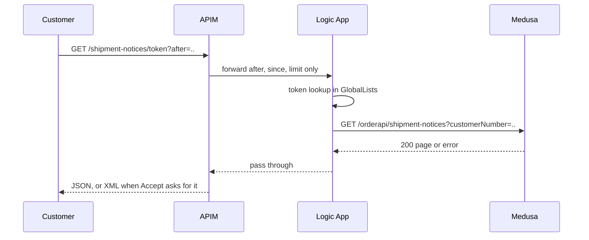

# Plan: Return shipment notices to API customers

**Key:** NIMBUS-130 · **Scope:** `scope.md` (approved 2026-10-19) · **Branch:** `feature/NIMBUS-130` from
`develop` · **Planned:** 2026-10-19 · **Revised:** 2026-10-19 after the independent review
(`plan-review.md`, findings F1–F8) · **Status:** approved by the human 2026-10-19; re-approved the same day with NIMBUS-192 folded in (task 12);
dispatch awaits a separate go-ahead

## 1. Summary [High]

API customers (first: Metz A/S) get a pull endpoint that returns the shipment notices of their API
orders since a watermark, as JSON or XML. A scheduled Medusa job finds Business Central's posted sales
shipments of API orders, keeps a tracking row per shipment, and checks each tracked shipment on a
bounded schedule. Each check records a numbered revision in the `orderIngestion` module when the
shipped lines changed. The read endpoint on `/orderapi` pages through those revisions by an opaque
cursor; APIM and a new Logic App workflow put the customer token in front of it, as for order
submission.

Four decisions shape it:

- **Lines are matched to the customer's lines by the BC line number captured at submission, and that
  map is written in the same metadata write as the BC outcome.** On TestDK each shipment line carries
  its sales-order line's number (70/70), and an item repeats on several lines in 48% of shipments. No
  step is added after the outcome is recorded, so nothing new can trigger the compensation that would
  erase an accepted BC order (review F3).
- **A shipment finds its order by customer number and external document number, then the order's
  current BC order number is confirmed (R2).** Both fields were copied unchanged from sales order to
  shipment in 11/11 TestDK orders checked. This needs no new column and works for orders sent before
  release.
- **Discovery and checking are separated.** Two forward scans (lead, and a trail 30 minutes behind
  for late-visible postings) walk fixed, count-sized time windows to the end with BC's server-driven
  paging, so they always make progress (F2). Found shipments become tracking rows. A check phase
  re-reads at most 200 due shipments per run, oldest due first, with backoff and a guaranteed final
  check after the 14-day window (F4–F6).
- **A revision is stored only against the revision it was decided from.** Each store runs in one
  transaction that locks a counter row and compares the expected latest revision. On a mismatch it
  stores nothing and the shipment is re-checked (F1). Correctness never rests on the job's lock.

**How to review this plan.** This plan is the human review gate: approving it is what allows
dispatch. Each section heading carries a review level. Answer the open items under Needs your decision
(section 2), then read sections 5 and 6 (data model, state tables; rated High because past misses were
found there) and the security matrix (7), and stop at every `Critical` flag. The task files hold more
depth but are not required reading. An uncertainty is often quicker to settle by asking the planning
agent in chat than by reading further.

## 2. Needs your decision [Critical]

Answered on 2026-10-19 ("all decisions to recommendations"). Where the review changed an item, it is
marked *revised*:

1. Capture the BC line number per customer line at submission. **Answer:** accepted. *Revised:* the
   map now lives in the order's BC outcome metadata, written in the same update as the outcome. No new
   column and no new step (F3).
2. Orders sent before release. **Answer:** accepted (their notices have null `line_number`/`ean_no`).
   *Revised:* no migration script is needed any more; those orders are found through decision 11.
3. Go-live guard on posting date, day granularity. **Answer:** accepted.
4. Late-visible postings, unmeasured (P6, UNVERIFIED). **Answer:** residual risk accepted; not
   blocking dispatch. *Revised:* covered by a trail scan 30 minutes behind the lead scan instead of a
   replayed overlap (F2). Re-measured on production.
5. A correction line that cannot be paired: skip and log. **Answer:** accepted. *Revised:* superseded
   by decision 8, which adds a retry.
6. Only `Item` lines reported; freight items with null EAN. **Answer:** accepted.
7. P3 production check as a pre-go-live check. **Answer:** accepted, not blocking.

Answered on 2026-10-19 to the review's questions:

- Drop-ship names and addresses in Logic App run history. **Answer:** accepted as is; no
  secure-inputs/outputs requirement.
- XML error bodies. **Answer:** yes. With `Accept: application/xml`, APIM renders 400/401/404/5xx
  bodies as XML too; the contract defines the XML error element (tasks 01, 10).

Answered on 2026-10-19 (accepted with their defaults; decision 8 extended by the human):

8. **Retry a shipment that could not be recorded (F5).** Today's decision 5 would lose it once it
   leaves the scan. *Default:* fix. The shipment stays a tracking row and is retried with backoff (15
   min, 1 h, 4 h, then every 6 h) until its window ends and a final check has run. After that it is
   closed as `gave_up` with an error log. **Answer:** accepted, with recovery from Medusa Admin: a
   page lists `gave_up` rows and "Retry" reopens one for the next run (task 11). There is no reopen
   for `window_ended` rows (planner default, not asked). A direct database reset stays the fallback,
   documented after ship.
9. **Final check after the window, even after downtime (F6).** *Default:* yes. Every tracked shipment
   gets one successful check after its 14-day window ends before it is closed. Trade-off: that check
   may also pick up a correction made after day 14, which is then reported as a revision.
   **Answer:** accepted.
10. **Force resend.** *Default:* revisions end for shipments under the old BC order number. On its
    next check the tracking row is closed `superseded` and nothing is recorded (consistent with R2).
    Their line map is then never needed again. **Answer:** accepted.
11. **Order lookup by customer number and external document number** (planner change, replaces the
    stored-BC-number column, to avoid F3). A shipment whose external document number was edited in BC
    is not matched. *Default:* accept. **Answer:** accepted.

Added 2026-10-19 with bug NIMBUS-192, folded into this epic by the human; answered and re-approved the
same day:

12. **Log the unknown customer number server-side?** *Default:* yes, one warn line with the number
    only. It is a business identifier for company customers. It may identify a sole trader, so the log
    line carries nothing else. **Answer:** accepted (sole traders flagged).
13. **Duplicate-order 422s keep echoing the caller's own `externalOrderNumber`?** *Default:* keep. The
    caller sent it, and it is no internal identifier. **Answer:** accepted.

## 3. Flows [High]

### A. Order submission keeps the line map (task 03)

1. The existing workflow sends the order header and then each line to Business Central.
2. For each accepted line, the adapter reads `sequence` from BC's 201 response. If it is absent, the
   line is still accepted and its BC line number is null.
3. The existing "record BC outcome" step writes the BC order number and the line map (customer line
   number, EAN sent, BC line number) in one metadata update. No step follows it. A force resend
   replaces both.

### B. Discovery run (task 06)

1. Skip the run while a BC throttling back-off is in force (state `bc_backoff_until`).
2. Read the poll state. On the first run, set the go-live time and both scan cursors to now, then
   end.
3. Lead scan: window from the lead cursor to now minus 15 minutes (settling). If BC counts more than
   1,000 headers in it, halve the window until it fits. A window that is a single timestamp is read
   whole, whatever its size (TestDK's largest tie group is 77).
4. Read every page of that window (`Prefer: odata.maxpagesize=200`, follow `@odata.nextLink`).
5. Trail scan: the same steps (3–4) with the trail cursor, bounded at now minus 45 minutes.
6. Match the headers to API orders in batches: company by BC customer number, then
   `order_external_reference` by company and external order number, then the order's current BC
   order number = `orderNumber` (R2), and posting date on or after go-live (R4).
7. Upsert a tracking row per matched shipment: a new row is due at its `lastModifiedDateTime` + 15
   minutes; for an open row, a newer header brings its due time forward. Closed rows are not touched.
8. Move each cursor to its window's end, only after the window was read completely and the upserts
   committed. A failure leaves the cursor where it was.

### C. Check run (task 07)

1. Select at most 200 tracking rows that are open and due, oldest due first.
2. For each, read the latest stored revision (number, hash, listed lines). That revision is the
   expected one.
3. Read those shipments with lines from BC, 20 numbers per request.
4. For each shipment:
   - if the order's current BC order number differs → close it `superseded` (decision 10);
   - if BC no longer returns it → back off;
   - otherwise the decision function nets corrections and decides: record, nothing, or unpairable.
5. Store each "record" against the expected revision (D). On a conflict nothing is stored and the row
   is due again at once.
6. Reschedule each row (section 6):
   - `cancelled` closes it;
   - inside the window it is due again in 15 minutes;
   - the first successful check after the window is the final one and closes it `window_ended`;
   - a failure backs off (decision 8).

### D. Storing one notice (task 02)

1. Open a transaction and lock the counter row.
2. Read the latest revision of this BC shipment. If it is not the expected revision → "conflict"; if
   its hash equals the new one → "unchanged". Either way commit without inserting.
3. Otherwise take counter + 1 as the cursor, insert revision expected + 1, update the tracking row,
   commit. A second writer waits at step 1, so commits happen in cursor order.

### E. The job (task 08)

1. Every minute, try the single-run lock once (TTL 10 minutes, per-run owner). If it is held, skip.
2. Run discovery (B), then checks (C), within a 4-minute run deadline: no new BC request starts after
   it, and an unfinished window is not advanced. Every BC request times out after 20 seconds.
3. Release the lock in `finally`.
4. Log one summary line with counts only:
   - duration and headers read;
   - lead and trail cursor lag;
   - due backlog size and oldest due age;
   - recorded, unchanged, conflicts, errors.
5. Warn when the lead lag or the oldest due age exceeds 60 minutes (stalled progress).

### F. Customer reads notices (tasks 09–10)

1. The customer calls `GET /shipment-notices/{token}` on APIM with `after` or `since`, optional
   `limit`, and an `Accept` header.
2. APIM forwards only `after`, `since` and `limit` to the new Logic App workflow.
3. The Logic App validates the token against the GlobalLists token list exactly as the order flow
   does (401 "Token not recognized" / "Not allowed") and calls Medusa
   `GET /orderapi/shipment-notices?customerNumber=…` with the secret key.
4. Medusa resolves the company through the shared company-resolution step (unknown → 404 "Customer
   not found"; task 12). It returns the notices above `after`, or
   recorded on or after `since`, oldest first, reading `limit` + 1 rows to set `has_more`.
5. The Logic App passes status and body through. With `Accept: application/xml`, APIM renders success
   and error bodies as XML; otherwise it returns JSON.

## 4. What gets built [High]

### 01 Shipment notice contract

The wire contract as code and as customer-facing artifacts. In code: a pure schema and type for the
success envelope, one notice and the error body, in the `orderIngestion` module (section 5,
"Contract"). As artifacts in the case folder for Metz: a JSON Schema, an XSD for the XML rendering
(success and error), and JSON and XML examples of both. Rules:
- nullable fields are `null` in JSON and omitted in XML;
- `status` takes only `shipped`, `revised` or `cancelled`;
- cursors are opaque decimal strings.

### 02 Shipment notice storage

Data model and module service (L0–L1) in `orderIngestion`, with a generated migration. Three tables:
- `shipment_notice`, one row per revision;
- `shipment_tracking`, one row per BC shipment of an API order, holding its check schedule;
- `shipment_notice_state`, a single row with the counter, the two scan cursors, the go-live time and
  the BC back-off.

Service methods:
- store a revision against an expected revision (flow D; returns stored, unchanged or conflict);
- upsert tracking rows from discovery;
- select due rows;
- reschedule or close a row;
- read and advance the poll state (the counter row is created on first use);
- list a company's notices after a cursor or since a time.

Rows are written only by the system (R9) and never deleted (R10).

### 03 Keep the BC line numbers at submission

The Business Central adapter (L2) reads `sequence` from each line's 201 response and returns it per
accepted line. The existing outcome step adds the line map to the BC integration state it already
writes in one order-metadata update; the state parser accepts older states with no map. No step is
added to the send-to-BC workflow, so a failure can never compensate away an accepted BC order (F3).

### 04 Business Central shipment reads

Adapter (L2), in a focused file beside the BC service:
- **count** of headers in a time window;
- **windowed header read:** ascending, server-driven paging with a page-size preference, following
  `@odata.nextLink` to the end; fields: id, number, order number, external document number, customer
  number, posting date, last modified;
- **full read by shipment numbers with lines:** 20 per request, OData-escaped.

Behaviour:
- maps rows to typed records (dates as `YYYY-MM-DD`, empty strings to null, line type decoded);
- 20-second timeout per request;
- a typed throttling error that carries BC's `Retry-After`;
- one OAuth token reused until 5 minutes before expiry, for these methods only.

It holds no domain rule.

### 05 Shipment notice decision and schedule

Pure decision functions (L5), the single home of R5–R7 and of the check schedule, registered in
`decisions.md`.

Line rules:
- sort lines by BC line number;
- net each correction against the nearest preceding positive line by BC line number (same item,
  unit and opposite quantity, else "unpairable");
- keep `Item` lines only;
- map BC line numbers to the customer's line number and EAN;
- hash a canonical, sorted list of (BC line number, item, unit, net quantity).

Outcome rules:
- decide "record" (with status and listed lines), "nothing" or "unpairable";
- build the payload in the contract shape.

Schedule rules: the next due time, the back-off steps, the final check after the window, and the close
reasons.

### 06 Discovery scan

Workflow (L3/L4) for flow B:
- steps read the poll state and size each window by count;
- they read the windows completely and match headers to API orders (company module through Query,
  `order_external_reference` through its service, order metadata through a narrow, commented Query
  read);
- they upsert tracking rows and advance the cursors.

The matching rule (R1, R2, R4) is applied in `transform()` through a pure function. A window is never
marked done until all its pages are read.

### 07 Shipment checks

Workflow (L3/L4) for flow C:
- select due rows;
- read their expected revisions;
- read BC by numbers;
- decide;
- store against the expected revision;
- reschedule.

The store step has no compensation (a stored notice may already have been read). Per-shipment
problems are collected and reported, never swallowed; the run reports `completed_with_errors` when
any occurred.

### 08 Polling job

Scheduled job (L7), the project's first. Every minute it takes the single-run lock (try once, skip if
held, TTL 10 minutes, per-run owner id, release in `finally`). It runs one orchestration workflow
that runs discovery and checks as sub-workflows within the run deadline, then logs the run summary
and the stalled-progress warnings (flow E). Logs carry counts, order numbers and shipment numbers
only.

### 09 Read endpoint

Route (L6) `GET /orderapi/shipment-notices`:
- its own authentication entry (secret API key, as `/orderapi/orders`);
- a strict query schema.

A read workflow (L4) resolves the company (unknown → 404 with a generic message, no number echoed),
lists notices and maps them to the contract. It is a pure read with no side effects. Contract tests
and security negative cases.

### 10 APIM operation and Logic App workflow

Azure deploy artifacts, no repo code:
- **APIM `GET /shipment-notices/{token}` policy:** forwards only `after`, `since`, `limit`. Outbound,
  when `Accept` asks for `application/xml`, it renders the success body to the contract XML and error
  bodies (400/401/404/5xx) to the XML error element, using `set-body`.
- **A new Logic App Standard workflow:** GET trigger, the same token check and 401 bodies as the
  order flow, the customer number URL-encoded, Medusa's status and body passed through.
- Parameters, deployment instructions and manual test calls.

### 11 Admin recovery for shipments that gave up

An Admin UI route lists the tracking rows closed `gave_up`, with numbers, order, company, error code,
attempts and time; it shows no address. A "Retry" action reopens a row for the next run.

Backend:
- two admin routes (L6) under `/admin` with Medusa's default admin authentication: a list read
  through Query, and a retry that runs a reopen workflow (L3/L4);
- the reopen step refuses any row not closed `gave_up` and records who reopened it and when;
- the reopened row is checked by the next run with the usual final-check and back-off rules, counted
  from the reopen time.

The page calls the backend through `admin/lib/client.ts` and follows the existing admin pages
(literal English text, as the other admin pages use; the translation-key rule is storefront-only).

### 12 One company-resolution step with a generic 404 (NIMBUS-192)

A shared, read-only step (L3) resolves a company from a BC customer number for both
`POST /orderapi/orders` and the shipment-notice read workflow. Today the POST's 404 message repeats
the customer number, and Medusa returns the message verbatim. With this step, an unknown number throws
not-found with the fixed message "Customer not found", and the number goes only to a warn log line
(decision 12). The order-ingestion workflow is rewired to call it before the duplicate check, which
keeps its 422 (decision 13). This fixes bug NIMBUS-192.

## 5. Data model [High]

| Entity / field | Meaning | Owner | Written by | Stored / derived | Mutable until | Retention, deletion | Index |
|---|---|---|---|---|---|---|---|
| `shipment_notice` (prefix `shpn`) | one revision of one posted BC shipment of an API order; holds names and addresses (not encrypted) | `orderIngestion` | store transaction (task 02) for the check run | stored | never updated | as long as the order (R10); no deletion, like `order_external_reference` | see fields |
| `.sequence` | cursor; unique, from the counter | " | store transaction | stored, integer | — | as row | unique; (`company_id`, `sequence`) |
| `.previous_sequence` | cursor of the revision replaced; null for revision 1 | " | store transaction | stored | — | as row | — |
| `.bc_shipment_id`, `.revision` | BC `salesShipment.id`; 1, 2, 3 … | " | store transaction | stored | — | as row | unique (`bc_shipment_id`, `revision`) |
| `.status` | `shipped` \| `revised` \| `cancelled` | " | decision (task 05) | stored | — | as row | — |
| `.content_hash` | hash of the canonical netted listed lines | " | decision | stored | — | as row | — |
| `.company_id`, `.order_id`, `.external_order_number` | from `order_external_reference`, never from BC customer fields | " | check run | stored (copied) | — | as row | `order_id` |
| `.bc_order_number`, `.shipment_number`, `.shipment_date` | BC `orderNumber`, `number`, `postingDate` (`YYYY-MM-DD` text) | " | check run | stored | — | as row | — |
| `.bc_last_modified_at` | BC `lastModifiedDateTime` when read | " | check run | stored | — | as row | — |
| `.payload` | header + lines in the contract shape (no cursor fields) | " | check run | stored, JSON | — | as row | — |
| `.created_at` | serves as `recorded_at` | " | ORM | stored | — | as row | — |
| `shipment_tracking` | one row per BC shipment of an API order found by discovery | `orderIngestion` | discovery (insert, due time), check run (schedule, close), store transaction (`latest_revision`) | stored | until closed | kept, like notices; no PII | unique `bc_shipment_id`; (`state`, `next_check_at`) |
| `.bc_shipment_id`, `.shipment_number`, `.bc_order_number`, `.posting_date` | from the BC header | " | discovery | stored | — | as row | — |
| `.company_id`, `.order_id`, `.external_order_number` | from the matched `order_external_reference` | " | discovery | stored | — | as row | — |
| `.latest_revision` | 0 until recorded, then the latest stored revision | " | store transaction | stored | each revision | as row | — |
| `.state` | `open` \| `closed` | " | check run | stored | close | as row | (above) |
| `.close_reason` | `cancelled` \| `window_ended` \| `superseded` \| `gave_up`; null while open | " | check run | stored | close | as row | — |
| `.next_check_at` | when it is due | " | discovery (earlier only), check run | stored | close | as row | (above) |
| `.recheck_until` | posting date + 14 days, end of day UTC | " | discovery | stored | — | as row | — |
| `.final_check_done` | a successful check ran after `recheck_until` | " | check run | stored | close | as row | — |
| `.closed_at` | when the row was closed | " | check run | stored | close | as row | — |
| `.reopened_at`, `.reopened_by` | last Admin retry and the admin user id (actor) | " | reopen workflow (task 11) | stored | each retry | as row | — |
| `.attempts`, `.last_error`, `.last_checked_at` | failure count since last success; error code only (no BC text, no PII); last successful check | " | check run | stored | each check | as row | — |
| `shipment_notice_state` (one row) | `last_sequence`, `lead_cursor`, `trail_cursor`, `go_live_at`, `bc_backoff_until` | `orderIngestion` | store transaction (counter), discovery (cursors, go-live), job (back-off) | stored | permanent | never deleted | key column unique |
| order `metadata.business_central_integration.bc_lines` | `[{ line_number, ean_no, bc_sequence \| null }]` per accepted line; absent on older orders | Medusa order (existing key, owned by the send-to-BC workflow) | `recordBcOrderOutcomeStep`, same update as the outcome | stored, JSON | each (re)send | as the order | none (read by order id only) |

Cardinality and relations:
- An API order has 0..N shipments (TestDK: 11 of 185 orders had 2–4).
- A shipment has one tracking row and 0..N revisions; the latest revision is the highest `revision`
  for its `bc_shipment_id` and equals `shipment_tracking.latest_revision`.
- The counter and state row is created on first use (insert-if-absent, atomic), never by a
  hand-written migration.
- `order_external_reference` is unchanged.

**Contract (wire names, task 01).**
- **Envelope:** `{ shipment_notices, next_cursor: string|null, has_more: boolean }`. `next_cursor`
  echoes `after` when the page is empty (null if none was sent).
- **Error body:** Medusa's errors are `{ type, message, code? }` (its error handler). Gateway errors are
  `{ error, message? }` (Logic App 401s, APIM validation).
- **Notice:**
  - `cursor`, `previous_cursor`, `recorded_at` (ISO 8601 UTC), `revision` (int), `status`;
  - `order_id`, `external_order_number`, `bc_order_number`, `shipment_number`, `shipment_date`
    (`YYYY-MM-DD`), `shipment_method_code`, `your_reference`;
  - `sell_to` and `bill_to`: {`customer_number`, `name`, `address_line_1`, `address_line_2`, `city`,
    `state`, `post_code`, `country`};
  - `ship_to`: {`name`, `contact`, `address_line_1`, `address_line_2`, `city`, `state`, `post_code`,
    `country`};
  - `lines[]`: {`line_number` (int|null), `ean_no` (string|null), `bc_line_number` (int),
    `item_number`, `description`, `description_2`, `unit_of_measure_code`, `quantity` (number, net),
    `shipment_date`}.
- **XML:** root `shipment_notice_response`, then `shipment_notices/shipment_notice` and `lines/line`;
  errors are `error_response` with `error` (Medusa `type`, or the gateway's `error`) and `message`
  (omitted when absent). Scalars are child elements; null fields are
  omitted.

## 6. Business rules as state tables [High]

**`shipment_tracking`** (actor: system; nobody else writes, R9)

| Current state | Event | Outcome | Side effects |
|---|---|---|---|
| none | discovery finds a header with a matching API order (R1, R2), posting date ≥ go-live (R4) | insert `open`, `latest_revision` 0, due at last-modified + 15 min | — |
| none | no API order matches (storefront, BC-entered, earlier BC number, external number edited in BC) | nothing | — |
| `open` | discovery sees a newer header | due time moved earlier only | — |
| `closed` | discovery sees it | nothing | — |
| `open`, due | check: order's current BC number differs | `closed` `superseded` (decision 10) | — |
| `open`, due | check: decision "record" and the store succeeds | `latest_revision` + 1; due in 15 min, or `closed` `cancelled` | a notice row (below) |
| `open`, due | check: "nothing" | due in 15 min; `attempts` 0 | — |
| `open`, due | check: store conflict | due now | re-decided next run (F1) |
| `open`, due | check: "unpairable", or BC did not return it | `attempts` + 1; due after back-off (15 min, 1 h, 4 h, then 6 h) | error logged with numbers only |
| `open`, now > `recheck_until`, not final | first successful check | `final_check_done`, `closed` `window_ended` | may record a revision (decision 9) |
| `open`, now > `recheck_until` | no success within 3 days of the later of the window's end and `reopened_at` | `closed` `gave_up` | error logged |
| `closed` `gave_up` | Admin "Retry" (task 11) | `open`, due now, `attempts` 0, `reopened_at`/`reopened_by` set | — |
| `closed` other reason | Admin "Retry" | refused (400) | — |
| `open` | BC failure or throttling during the run | unchanged | back-off in state when throttled |

**`shipment_notice`** (actor: system, via the store transaction)

| Current state | Event | Outcome | Side effects |
|---|---|---|---|
| no revision | "record" with some line net > 0, expected revision 0 | revision 1 `shipped`, lines with net > 0 | counter + 1 |
| no revision | every line nets to 0 | nothing | — |
| revision N `shipped`/`revised` | "record", changed hash, expected N, some listed line > 0 | revision N+1 `revised`; every line listed in N, 0 where undone | counter + 1; `previous_sequence` = N's cursor |
| revision N | same, all listed lines 0 | revision N+1 `cancelled` | as above; tracking closed |
| revision N | expected revision ≠ N (a newer revision was stored meanwhile) | nothing ("conflict") | tracking due now |
| revision N | hash equals N's | nothing ("unchanged"), no cursor taken | — |
| any | two workers store at once | serialized by the counter row; the second gets conflict or unchanged | unique (`bc_shipment_id`, `revision`) is the backstop |

Precondition: the store is refused when company or order is missing; the company comes only from
`order_external_reference`.

**Poll state** (actor: system)

| Current state | Event | Outcome |
|---|---|---|
| no row | first run | create: go-live, lead and trail cursors = now; no BC read |
| cursor C | window (C, U] read completely and tracking committed | cursor = U |
| cursor C | BC failure, deadline reached mid-window | unchanged |
| any | BC throttles | `bc_backoff_until` = now + `Retry-After` (at least 1 min); runs skip until then |

**Order BC outcome** (existing state, one new field): a sent or partial outcome writes `bc_order_number`
and `bc_lines` together. A failed or skipped attempt leaves both. The existing compensation restores
both only if a later step of the same workflow fails, and no step follows it.

## 7. Security-property matrix [Critical: personal data, cross-company access]

| Property | Control | Trust root | Failure behaviour | Negative test |
|---|---|---|---|---|
| Only a known token reads notices | Logic App GET workflow checks the token against GlobalLists | GlobalLists + Logic App | 401 "Token not recognized" / "Not allowed"; Medusa not called | manual test calls (task 10) |
| Medusa accepts only the Logic App | Secret API key; own `authenticate` entry for `/orderapi/shipment-notices*` | Medusa secret key | 401 | no auth → 401; publishable key → 401 (task 09, `security-boundaries.spec.ts`) |
| A customer sees only its own notices | Filter by the company resolved from `customerNumber`, set only by the Logic App | Logic App (admin-equivalent key, accepted NIMBUS-129 trade-off) | never another company's row | company A's number never returns B's notices (task 09) |
| Caller cannot inject parameters | APIM forwards only `after`, `since`, `limit`; Medusa schema is strict | APIM policy, Zod | dropped by APIM; 400 at Medusa | unknown parameter → 400 (task 09); injected `customerNumber` ignored (task 10) |
| Unknown customer reveals nothing (GET and POST) | Shared step throws not-found with a fixed message; the number is logged only | code; Medusa's handler returns the message verbatim | 404 | body has no number: GET (task 09), POST (task 12) |
| A shipment is attached to the right order | Company by BC customer number, order by external number within that company, confirmed by the current BC order number | Medusa data | unmatched shipments skipped | other company's external number, earlier BC number and non-API order → not tracked (task 06) |
| Personal data not in job or route logs | Counts, order and shipment numbers only; `last_error` holds codes | code review | — | a failing check's log and `last_error` contain no address (task 07) |
| Only admin users list or retry gave-up rows | Medusa's default `/admin` authentication (user: bearer, session, api-key) | Medusa auth | 401 | no auth, store token, publishable key → 401 (task 11) |
| The Admin list carries no personal data | Numbers, ids, company name and error codes only | code review | — | field assertion (task 11) |
| Personal data in Logic App run history | Not protected | — | — | accepted by the human 2026-10-19 |
| Replay | Pure read | — | acceptable | none needed |
| Retention | Kept as long as the order (R10) | policy | — | none (decided in scope) |

## 8. Decisions [New in this plan: High; from the scope: Medium]

New in this plan, verified or not:

- **Line match by BC line number captured at submission (P1).** Why: shipment line `sequence` equals
  the order line's (70/70 on TestDK), and the same item repeats on lines in 9,666 of 20,000 shipments.
  `verified` (probe 5).
- **BC line POST returns `sequence`.** BC returns the full `salesOrderLines` object on 201 ("all of
  the properties will be returned"), and the entity has `sequence`. `verified` (Microsoft Learn
  "Create salesOrderLines"; metadata snapshot). Confirmed again at the TestDK end-to-end check;
  null fallback kept. This settles the review's correction 3: it does not block dispatch.
- **Line map in the outcome metadata write, no new step (F3).** Installed workflows-sdk registers
  compensation for executed steps when a later step fails. The outcome step's compensation restores
  the pre-submission state, and BC orders cannot be undone. `verified` (review, from
  `@medusajs/workflows-sdk` 2.21.2 and `@medusajs/orchestration`; `record-bc-order-outcome.ts`).
- **Order lookup by customer number + external document number, confirmed by the current BC number
  (decision 11).** `verified`: both fields equal on 11/11 TestDK orders (probe 7).
- **Undo netting: nearest preceding positive line by BC line number (P8, F8).** 559/559 pairs.
  `verified` (probe 5).
- **Undo leaves the header's `lastModifiedDateTime` unchanged (P6).** 7 confirming cases, 0
  contradicting. One undo happened the day after posting. `verified` (probe 5).
- **Late visibility (P6): `UNVERIFIED`.** Risk accepted by the human; covered by the trail scan.
- **Go-live guard on posting date (R4).** About 70% of headers are re-modified on later days.
  `verified` (probe 5).
- **Discovery by count-sized windows read to the end with server-driven paging (F2).**
  - A `lastModifiedDateTime` OR keyset filter returns HTTP 501 on BC.
  - `$count` with a filter works, and `Prefer: odata.maxpagesize` returns `@odata.nextLink` with a
    `$skiptoken`.
  - Tied timestamps exist (a group of 77).
  - `verified` (probes 7–9).
- **Tracking table with a bounded, rotated check schedule (F4, F5, F6).**
  - Capacity: 200 checks per run, 3,000 per 15 minutes.
  - Maximum detection delay: 15 minutes plus one run while fewer than 3,000 rows are due. Beyond that
    the backlog-age warning fires.
  - Real volume is small (API orders only).
- **Store against the expected revision (F1).** The counter lock alone orders commits but not
  observations.
- **Lock TTL 10 minutes.** Justified by a 4-minute run deadline, 20-second request timeouts and at
  most about 30 BC requests per run.
- **One token per run.** Expiry-aware reuse in the new adapter methods only; BC token TTL 3,599 s
  (probe 6).
- **The store step has no compensation.** A stored notice may already have been read.
- **Counter row rather than an advisory lock plus `max(sequence)`.** A max would reuse numbers if a
  row ever disappeared.
- **One shared company-resolution step with a generic 404, used by GET and POST (task 12, bug
  NIMBUS-192).** Medusa's error handler maps `NOT_FOUND` to 404 and returns the error's message in
  the body unchanged; it logs 4xx messages at info level. `verified` (`@medusajs/framework@2.21.2`
  `dist/http/middlewares/error-handler.js`).
- **Does the framework already do this?** Medusa has no shipment, BC or cursor-feed primitive;
  scheduled jobs, locking, `runAsStep` and module services are used as shipped. No core internal is
  called.

From the scope:
- shipment notices, not confirmations (Q9);
- polling only, no BC change (Q8);
- data model in `orderIngestion` and the cursor design;
- revisions with a 14-day re-check and 15-minute settling (Q13, Q13a);
- EAN from the customer's line (Q10);
- no carrier, tracking or weights (Q11), no prices (Q14);
- JSON from Medusa, XML by APIM on `Accept` (Q12);
- canceled orders still reported (Q15);
- no back-fill (Q16);
- EDI DESADV keeps running (Q12b);
- page size 50/200 (Q6);
- retention as the order (Q7);
- lock provider in NIMBUS-179 (P4, P5).

## 9. Framework assumptions [Medium; Critical rows flagged]

| Primitive | Verified input, output, side effect | Evidence |
|---|---|---|
| Scheduled job | default export `(container)`, `config { name, schedule }`; runs inside a generated workflow; loaded on every `worker`/`shared` instance | `@medusajs/framework@2.21.2` `dist/jobs/job-loader.js`; scope Facts |
| Admin route authentication | every `/admin` route gets `authenticate("user", ["bearer", "session", "api-key"])` by default | `@medusajs/framework@2.21.2` `dist/http/router.js` (`_ApiLoader_applyAuthMiddleware`) |
| Error handler | `NOT_FOUND` → 404 `{ code, type: "not_found", message }` with the thrown message verbatim; 4xx message logged at info | `@medusajs/framework@2.21.2` `dist/http/middlewares/error-handler.js` |
| Locking module | `acquire(key, { ownerId, expire })` throws when held; `release(key, { ownerId })` | `subscribers/business-central-order-ready.ts` and its spec |
| Workflow compensation | a failing later step compensates earlier executed steps | review F3 (installed workflows-sdk / orchestration 2.21.2); hence no new step after the outcome |
| Transaction + raw SQL in a module service | `@InjectManager` / `@InjectTransactionManager`, `manager.execute` in one transaction; row locks held to commit | `modules/storefront-translation/service.ts`; Postgres semantics; interleaving test in task 02 |
| BC `salesShipments` | `gt`/`le` window, `$orderby` asc, `$count` with filter, `Prefer: odata.maxpagesize` + `@odata.nextLink`, `number eq … or …` (20) with `$expand` lines; unknown number → 200 empty; OR-keyset filter → 501 | probes 6–9 (TestDK, GET) |
| BC `salesOrderLines` POST response | 201 with the full object including `sequence` | Microsoft Learn "Create salesOrderLines"; metadata line 2595 |
| BC token lifetime | `expires_in` 3,599 s | probe 6 |
| BC visibility lag | `UNVERIFIED`; risk accepted by the human 2026-10-19; not blocking | — |
| APIM `set-body` with `JObject`, `XElement` | allowed in policy expressions | Microsoft Learn "API Management policy expressions"; `JObject` deployed in NIMBUS-145 |
| Logic App Request trigger with GET | method selectable; query values via `triggerOutputs()['queries']` | Microsoft Learn; checked by the task 10 test calls |

## 10. Open risks and gates [Medium]

| Risk or gate | Owner | Blocking |
|---|---|---|
| P3: read a few production shipments of API orders (read-only): `orderNumber`, `externalDocumentNumber` and `customerNumber` as expected, `number` = Metz's DESADV `DocumentNo` | lead dev | before go-live |
| TestDK end-to-end: submit an API test order, post a shipment and an undo; confirm the line map and a `shipped` then `cancelled`/`revised` notice | lead dev with BC consultant | before go-live |
| Late-visibility lag: measure on production after go-live | lead dev | no |
| Stalled-progress warnings are log lines; a log alert in Medusa Cloud has to be configured | lead dev | before go-live |
| NIMBUS-180 changes the same adapter code (`createSalesOrder`, line POST) and must keep returning the BC line number per accepted line; notices do not depend on it otherwise | lead dev | no |
| NIMBUS-179 not shipped: duplicate BC reads across instances only | — | no |
| Azure deployment of task 10 artifacts | Azure environment owner | before go-live |
